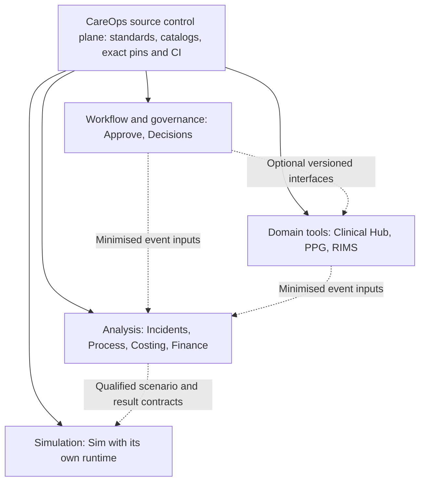

# CareOps

CareOps is an organisation-neutral, modular suite for safer administrative and
clinical-governance workflows. It provides shared architecture, governance,
validation, delivery controls and deployment profiles for independently
versioned CareOps modules.

The repository is the portfolio control plane. It does **not** store operational
exports, practitioner or patient records, credentials, tenant identifiers,
secrets, production logs, generated findings or authoritative business records.

## Architecture

CareOps uses a polyrepo model:

- each module remains independently versioned, tested, licensed and deployable;
- this repository carries shared standards, integration contracts, release
  manifests, portfolio assurance and deployment profiles;
- organisation-specific rules and configuration live in profiles rather than in
  the reusable module core; and
- modules communicate through versioned contracts and stable identifiers rather
  than shared databases or copied implementation details.

This preserves a small blast radius and allows CHHHS or another organisation to
start with one bounded capability without adopting the entire portfolio.

## The full system

The intended system combines independently usable capabilities through optional,
versioned interfaces. This is the target architecture, not a claim that the
modules are all composed, installed or operational today. Approve and optional private Incidents are
currently materialised as business submodules in this parent; Incidents is
qualified only for source structure and fictional staging, not native operation.

| Module | Standalone purpose | Optional contribution to the wider system |
| --- | --- | --- |
| `careops-approve` | Intake, checks, routing and human approval capture | Reviewed request/result handoffs with governance providers |
| `careops-decisions` | Governance bodies, recommendations, decisions and actions | Generic governance services where another module needs them |
| `clinical-hub-core` | Meeting preparation, agendas/papers, minutes and follow-up tooling | A focused meeting capability; reconcile overlap with Decisions before sharing implementation |
| `careops-ppg` | Policy/procedure/guideline preparation and lifecycle tools | Versioned document references and reviewed workflow interfaces |
| `careops-rims` | Publications ingestion, attribution and reporting | Source-qualified publication references and selected reporting outputs |
| `careops-process` | Privacy-minimised event/file ingestion and process analysis | Optional conformance, delay and rework analysis across selected workflows |
| `careops-incidents` | Governed incident/safety analytics | Controlled minimum-necessary signal references; operational data and findings remain outside source control |
| `careops-costing` | Workload, capacity, cost and benefit calculations | Optional activity/aggregate inputs and reproducible calculation outputs |
| `careops-finance` | Governed finance reporting and semantic models | Optional aggregate/reporting interfaces and reusable ALM patterns |
| `careops-sim` | Independent Rust/Kairos simulation | Versioned synthetic scenario/result interfaces; retains its own runtime |



The diagram shows logical composition, not a central runtime or mandatory data
flow. Each module owns its records and release lifecycle. Shared identity and
navigation can use existing qualified platform capabilities when needed; a single
mandatory portal, database or live parent service is not required. Clinical Hub
and Decisions must agree ownership before sharing agendas, minutes or actions;
there must be one authoritative record for each purpose.

Power Platform, SharePoint and Microsoft 365 remain the operational platforms for
applicable modules. Local tools prepare and verify source and fictional fixtures;
Sim keeps its separate Rust/Kairos execution model. Adapters carry stable,
source-qualified IDs, revisions, correlation/idempotency keys and explicit error
and absence behaviour. Analytics, simulation and AI remain optional consumers.

## Carryover approach and priority

The [registered Conductor tracks](conductor/tracks.md) cover all ten modules;
the [suite queue](conductor/suite-delivery.md#module-carryover-order--18-october-2026)
and [module profile](.careops/module.json) define the current execution order:

1. **Incidents first:** the optional private source pin, structural/fictional
   checks, selective checkout and source rollback are qualified. Native/privacy
   and public-redistribution work remain separate and open.
2. **Process second:** preserve the current work and select a stable completed
   revision with its existing owner before pinning.
3. **Finance → Costing → Decisions**, followed by **Clinical Hub → PPG → RIMS →
   Sim**, taking the next eligible bounded step without disturbing active work.
4. **Approve:** maintain its existing pin independently; do not import it twice
   or change existing release contracts as a side effect.

Carryover retains independent repositories and history. Review source privacy,
licensing, standalone commands and actual dependencies; record the exact selected
commit; add a gitlink/catalog/publication-inventory change only when qualified.
A public parent does not grant access to private children or permission to publish
their histories. No repository is made public by this plan. Child licences remain
independent of this parent's MIT licence.

Verify a clean parent checkout without optional modules and selective child
initialisation, the affected synthetic scenario, compatibility/absence/replay and
source rollback. Keep prior pins and working runtimes. Native packaging, access,
outputs and recovery need their own technical qualification; green source checks
do not establish deployment or operational acceptance. Real business adjudication
is later operational work, not a universal prerequisite for software setup.

**CGov remains separate.** The existing Legacy Migration catalog and credentialing
tracks, contracts and N11 cutover are retained, but are outside this carryover
queue. No CGov mapping, source replacement or operational cutover is scheduled by
these tracks. See [the module catalog](portfolio/module-catalog.md) for status.

## Structured documents

Evaluate SharePoint structured document generation first for maintained agendas,
meeting packs/minutes, policies, procedures, guidelines, memos and reports. Use
maintained Word templates and structured inputs from the existing source of truth;
keep calculations, record selection and business decisions in their owning layers.
Preserve document kind, occurrence/period/source identity, included record IDs,
source/template versions, output revisions, human edits, unresolved concerns and
issued history. Qualify actual output, links, repeating/optional sections, editing,
access and retry/recovery before replacing a working route. Retain a supported
fallback for a recorded gap. Generation does not review, approve, issue or circulate
content; no licence purchase, consent or settings change is implied.

## Existing CHHHS deployment profile (separate workstream)

The initial CHHHS profile is documented in
[`profiles/chhhs/README.md`](profiles/chhhs/README.md). It adapts the generic
modules to credentialing, scope of clinical practice, committee governance and
PPG assurance while keeping Queensland and CHHHS authority separate from the
reusable code.

The coordinated draft contract is in
[`portfolio/credentialing-mvp-compatibility.json`](portfolio/credentialing-mvp-compatibility.json).
It identifies the participating module versions, boundaries, promotion gates and
status-claim limits. It is not a deployment or approval record.

## Delivery model

CareOps is delivered as small, reversible increments:

1. **MVP:** synthetic data, one bounded pathway, deterministic validation,
   human decisions and complete audit evidence.
2. **Silent pilot:** retrospective or prospective comparison with the current
   process, without changing the source system.
3. **Limited integration:** approved writes and notifications only after the
   pilot, privacy, cyber, records, clinical-governance and operational gates
   pass.
4. **Regular releases:** small capability packs behind feature flags, with
   measurable benefits and rollback evidence.
5. **Scale decision:** broader deployment only after safety, quality, workload,
   user-experience, cost and operating-effectiveness evidence supports it.

AI may extract, reconcile, summarise, draft and identify exceptions. It may not
make credentialing, scope, appeal, employment or other materially adverse human
decisions. Deterministic checks and accountable human approval remain the
controlling path.

The current adopt/evaluate/defer position for AI, agents, MCP, OCR, process
mining and Power Platform features is maintained in
[`docs/feature-radar-2026.md`](docs/feature-radar-2026.md).

## Agent support

Repository-scoped custom agents are under `.github/agents/`. Reusable Agent
Skills are under `.github/skills/`, including:

- `modular-capability-delivery`: selects the owning module and specifies a small,
  feature-flagged, reversible release; and
- `regulated-ai-assurance`: enforces source provenance, privacy, deterministic
  controls, human review, fallback and deployment evidence.

Agents and skills assist development and assurance. The repository, current
sources, approved deployment profile and accountable humans remain authoritative.

## Repository topology

`careops-approve` and optional private `modules/careops-incidents` are pinned
submodules. Other modules remain catalogued until selected for qualification.
The Conductor skill repository is a development submodule.

A normal clone and public CI do not fetch any module. Initialise only what you
need; avoid blanket recursive initialisation when private access is unavailable:

```bash
git submodule update --init -- careops-approve
# Existing authorised Git access to the private Incidents repository is required:
git submodule update --init -- modules/careops-incidents
python3 portfolio-scripts/qualify_incidents.py --receipt .local/incidents-qualification.json
```

The Incidents source reference retains its upstream MIT licence and private
history. Historical findings, private bindings and an unreviewed template remain
inside that private repository; they are not copied into this public parent.
Public-source redistribution is not qualified. The source check uses temporary
fictional inputs and verifies structure, counts, repeat and missing-source refusal.
It does not verify native rendering, small-cell suppression, freshness or live
refresh. See the [bounded carryover record](conductor/tracks/suite_incidents_migration_20261018/plan.md)
and [exact source manifest](portfolio/incidents-source.json).

## Licence

Original material in this parent repository is licensed under the MIT License.
Submodule contents and other repositories retain their own licence terms; this
licence does not grant redistribution rights over child modules or third-party
components.

## Public-source boundary

This source-only edition starts with fresh history. Earlier private history and
GitHub records remain privately archived. Deployment destinations belong in
private profiles; publication does not change their authority. Local business
document drafts, evidence receipts and workflow artifacts are excluded.

`PUBLIC_SOURCE_FILES.json` is the reviewed source inventory. Run
`python3 portfolio-scripts/validate_public_source.py` and the existing portfolio
checks before publication. An addition needs an explicit inventory update and
content review. The [hosting boundary](portfolio/host-capabilities.md) explains
which checks run automatically and which require private-module access. The
existing [suite queue](conductor/suite-delivery.md) remains the delivery plan.
