# Credentialing MVP end-to-end synthetic harness

Status: repository implementation; no tenant deployment

## Purpose

Exercise the coordinated routine-renewal sequence across the CareOps boundaries without using practitioner information or producing an operational credentialing effect.

## State sequence

```mermaid
flowchart LR
    A[Read-only source observation] --> B[Human source reconciliation]
    B --> C[Credentialing officer confirms completeness]
    C --> D[Service capability confirmed]
    D --> E[Committee readiness, quorum and conflicts confirmed]
    E --> F[Committee recommendation recorded]
    F --> G[Separate delegated decision recorded]
    G --> H[Decision result reconciled]
    H --> I[Privacy-minimised process event]
    I --> J[Decision recorded, not activated]
```

## Implemented controls

- synthetic, non-production fixture only;
- no name, email, registration number, qualification, credential document, referee report, decision reasons, patient data or raw source payload;
- source observation must be confirmed by a human;
- evidence completeness, current authority and service capability must be confirmed;
- committee readiness, quorum, conflicts and relevant-peer input must be complete;
- committee recommendation and delegated decision are separate human acts and roles;
- AI cannot make or attempt the decision;
- production, register, roster, access and release-to-practise writes remain disabled;
- events are deterministic, unique, chronological and marked observed with confidence one;
- terminal state is `decision-recorded-not-activated`; and
- the generated receipt carries an explicit evidence ceiling.

## Negative-path tests

The harness must fail closed when:

- the source record remains unreconciled;
- evidence is incomplete;
- current authority or service capability is unverified;
- quorum, conflict management or relevant-peer input is incomplete;
- recommendation and delegated-decision roles are conflated;
- AI attempts the decision;
- a production, register or release write is enabled; or
- prohibited case-level fields enter the fixture.

## Evidence ceiling

Passing the harness establishes a source-controlled synthetic state sequence and interface boundary. It does not establish current CHHHS policy, delegation, data quality, Microsoft tenant deployment, live-system integration, committee performance, an individual credentialing decision, register activation or operating effectiveness.

## Next gated increment

After governance, privacy, records, security, architecture and source-system access approval, replay the same states using a minimum-necessary read-only observation from the current platform. The current process and source system remain authoritative throughout the retrospective and prospective silent comparison.
