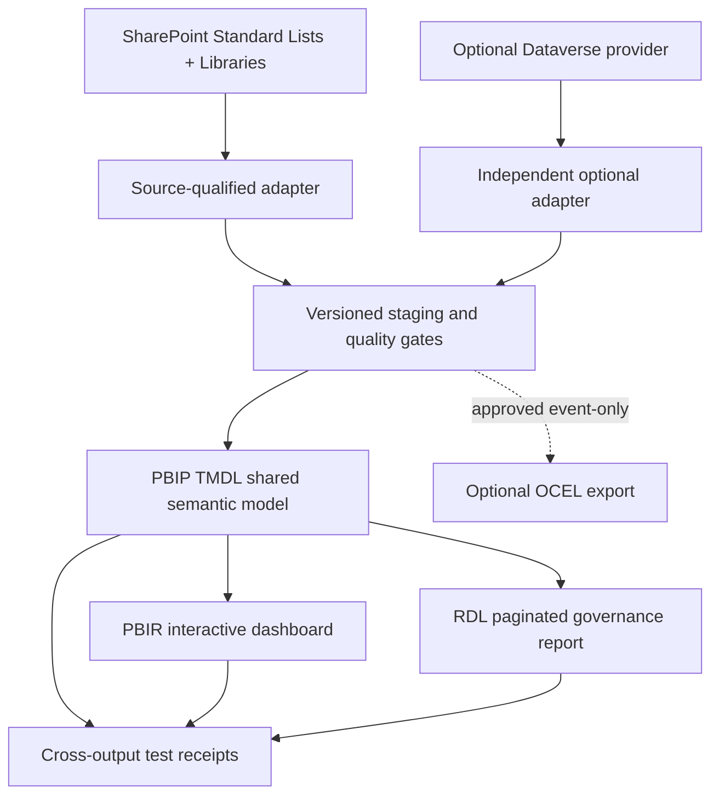

# Reusable governance analytics design

## Canonical model and ownership

**Operational truth:** Decisions authority for decisions/actions; Clinical Hub for meeting preparation/minutes workspace; original SharePoint/Dataverse record store, including exact source version and access classification. Report model is a **read-only, refresh-scoped projection**, never a governance writer. The model must not combine incomplete data from different refresh times without labeling the mismatch.

## Grain and dimensional contracts

| Table | Grain | Essential IDs / semantics |
|---|---|---|
| DimGovernanceBody | One source-qualified body version | BodyKey, parent, status, ToR revision, effective interval |
| DimForum | One forum/profile revision effective interval | ForumKey, BodyKey, ProfileRevision, template/version, authority state |
| DimMeetingOccurrence | One occurrence revision/as-of snapshot | OccurrenceKey, ForumKey, SeriesKey, local timezone, cancelled/exception/replacement |
| DimDate | One calendar date | DateKey, business date, local timezone policy separately |
| DimActorRole | One effective authorised role mapping | Source actor identifier, role, body, effective interval; no forced person enrichment |
| DimStatus | One domain/state mapping revision | Distinct meeting/minutes/decision/action states |
| DimSource | One source system and contract version | Source, mapping, provider, coverage as-of |
| FactAgendaPaper | One versioned agenda-paper association | OccurrenceKey + AgendaItemKey + PaperKey + revision, due/received, readiness |
| FactAttendance | One occurrence + member/role attendance fact | quorum eligibility, observed/declared attendance, source |
| FactMinutesRevision | One minutes revision | approval, issue status, reviewer, corrected-on, source hash |
| FactDecisionState | One decision + state-effective interval | conditions/dissent refs, authority, issued/held/amended/superseded, source key |
| FactActionState | One authoritative action + state-effective interval | owner accepted, due/review date, reported completion vs accepted closure |
| BridgeDecisionAction | One unique versioned decision-action link | prevents fanout double counts |
| BridgeMeetingAction | One unique occurrence-action association | referral/carry-forward is not a new action |
| FactOutcomeReview | One outcome measure + review occasion + version | target, observation, method, uncertainty, authority, review state |
| FactEvidenceLineage | One provenance assertion / source-version edge | decision/action/outcome, document/policy/ToR edition, source URI+hash, relationship |
| FactAutomationEvent | One minimised technical operation/event | trigger, attempt, state, retry, recovery, verified timestamp |
| FactReadSnapshot | One source/list/refresh receipt | last complete read, row count, partial/denied/stale, schema version |
| FactEffortObservation | One explicitly measured work/effort interval | stage, operator scope, correction/rework, comparator/baseline |

**Temporal safety:** store event datetime as zoned UTC plus source timezone; use separate effective dates and observation-as-of. Historical views require state-effective interval reconstruction, not a current-state filter applied retroactively. A Power BI Date table can filter measures without assuming local-zone conversions. **Privacy:** omit clinical narratives, transcripts, correspondence bodies, private people details and raw document content by default.

## Measure contract (same definitions across PBIR and RDL)

Each measure requires a canonical ID, precise population, grain, numerator/denominator, missingness, filter context, as-of semantics, data-quality gate and evidence link. Initial set:

| ID | Measure | Defined interpretation |
|---|---|---|
| GOV-01 | Active governance bodies | Distinct currently qualified bodies, excludes unresolved authority |
| GOV-02 | Adopted ToR review overdue | Distinct active ToRs whose approved review date is past as-of |
| MTG-01 | Meetings scheduled / cancelled | Distinct occurrence IDs, effective status/as-of; separate counts |
| MTG-02 | Quorum achieved rate | Verified quorum-positive occurrences / occurrences with verified quorum assessment; unknown shown separately |
| MTG-03 | Agenda and paper readiness | Ready occurrences / eligible reviewed occurrences; incomplete papers a distinct state |
| MTG-04 | Secretariat preparation and minutes approval lead time | Timestamp differences only for matched complete observed events, in specified business days/hours |
| DEC-01 | Adopted decisions | Distinct approved decision IDs within effective period; no drafts |
| DEC-02 | Decisions overdue for review | Distinct adopted active decisions with accepted review due date before as-of |
| DEC-03 | Conditional/dissenting decisions | Distinct adopted decisions carrying condition/dissent evidence refs; counts never infer meaning from unstructured text |
| ACT-01 | Open/held/referred/reopened actions | Distinct authoritative action IDs at selected as-of, separate state breakdown |
| ACT-02 | Overdue accepted actions | Action requires accepted owner/date, is unresolved and due before as-of |
| ACT-03 | Reported complete awaiting acceptance | Reported completion evidence exists, governance closure not accepted |
| ACT-04 | Reopen/rework rate | Distinct reopened actions / eligible actions with verified state-history coverage |
| OUT-01 | Outcomes evaluated | Distinct prespecified outcomes with reviewed observation and method / eligible outcomes; not evaluated separate |
| OUT-02 | Outcome attainment | Reviewed observation meets prespecified direction/target; no causal attribution without design |
| EVD-01 | Decision evidence completeness | Adopted decisions with required source/version/authority/conditions status / eligible decisions |
| EVD-02 | Superseded source exposure | Active decisions explicitly linked to a superseded source edition; flag for review, not invalidation |
| AUTO-01 | Automation completion and recovery | Accepted completed operations / eligible operations with complete receipts; failures/retries separately |
| DQ-01 | Complete, fresh source coverage | Required source scopes with verified complete/fresh receipts / required source scopes; unavailable separately |
| EFF-01 | Net secretariat effort change | Comparable measured baseline minus current time including correction/rework; no saving claim without comparable observations |

No numerator or denominator counts may be inferred from missing data. Date, source completeness and authorised viewer filters apply **before** aggregation. Row-level evidence and joined dimensions must reconcile to distinct source-qualified identities.

## Dashboard design (PBIR)

1. **Executive governance:** overview of active forums, decisions, overdue matters, reviews and outcome evidence; selected forum/period drill.
2. **Secretariat:** next meetings, agenda/paper readiness, delayed inputs, minutes review queue, prep/rework time.
3. **Chair:** conditional decisions/dissent, adoption/authority gaps, accepted ownership, unresolved and overdue actions.
4. **Outcomes:** expected vs observed outcomes, not-evaluated backlog, decision-to-outcome latency, measure methodology.
5. **Reliability and audit:** pagination/ETag/completeness, source-read freshness, exceptions, recovery, policy edition drift, permission-suppressed visibility.
6. **Cross-forum:** comparable rates only for common qualified denominators; show coverage and source/grain differences.

Global filters: body/forum/meeting series/occurrence, event/as-of period, outcome type, authority state, record visibility and source coverage. No insecure details or blank values rendered as zero. Drill-through to source only when native permissions permit. Ensure accessible labels, keyboard navigation, colour-independent states and no export that bypasses source access.

## Paginated report design (RDL)

**One shared semantic model** via approved Power BI dataset connection; parameterised `ForumKey`, `PeriodStart`, `PeriodEnd`, `AsOfUtc`, `ReportEdition`, `AudienceClass`. Never allow a caller-supplied audience parameter to *grant* access. Sections: title/edition/scope; governance and meeting summary; actions open/held/overdue; decisions including conditional authority; outcome-review table; data-quality and exceptions; provenance/source-version appendix; approval/issue status and controlled footer. Repeat header/footers, real page breaks, bounded long text, no orphan summary row. Capture exact semantic-model and output digest in private issue receipts; generated report is draft until approved.

## Security & qualification

For SharePoint source, native permissions must be enforced at extraction and shared model/report access; Power BI RLS cannot manufacture SharePoint per-item permissions if broad ingestion already occurred. Use least-privilege scoped extracts, viewer-role tests and restricted detail exclusion, with conservative small-cell suppression for broader aggregates. Dataverse path retains its own role/membership enforcement. RLS and RDL export permission tests require an actual test identity/tenant and cannot be qualified by synthetic source alone. Measure and schema coverage, structure validation, output rendering and native release are **different** gates.

## Existing work

Keep legacy Decisions `dataverse-dashboards.yaml` and accepted May 2026 ADR as historical source and optional Dataverse implementation contracts. Do not replace or assert equivalence. New analytical contract is additive and source-neutral; reconcile with RMS PR #312 when reviewed. Do not make PBIP/RDL core dependencies or introduce Fabric for a non-premium workaround.
