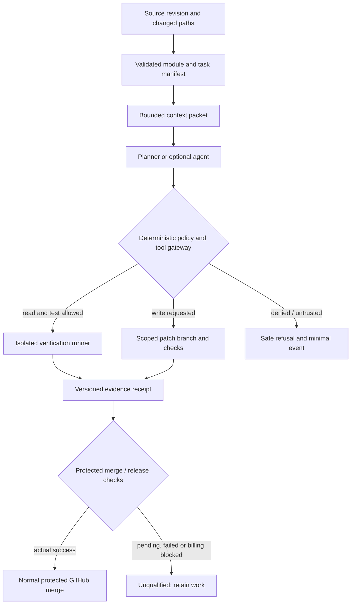

# Technical design: secure, context-efficient engineering

## Existing foundation

- Parent source is modular: Approve, Decisions, Clinical Hub, PPG, Process, Incidents, Finance, Costing and Workforce are integrated; Sim and RIMS are optional pinned gitlinks in the inspected `main`. Do not turn physical source colocation into runtime coupling.
- `AGENTS.md`, `.github/agents/`, `.github/skills/`, `harness/`, `.careops/module.json`, `portfolio/repos.json`, `portfolio-scripts/run_tests.py` and `.careops-security/` are the canonical implementation candidates.
- Existing security workflow, privacy workflow, shared source-security controls and Conductor are retained. Source-only passes never authorise live native operation.
- Some child modules already use Hypothesis, mutation/metamorphic tests and Playwright. Inventory actual executable test suites before creating replacements.

## Required control plane (small, offline by default)

The LLM is an untrusted planner/helper, **never** the security or release policy authority. Inputs from GitHub issues, docs, search and external tool outputs are data, not instructions. A deterministic gate validates tool/target/path classification and intended operation before invocation. Tool powers are non-transitive between agents. No ambient token inheritance, automatic client login, unbounded shell, unrestricted network or automatic production writes. Use no agent at all for repeatable checks, transformations, matching, builds and validation.

## Context engineering

Generate a *minimal* context packet from the selected SHA, `portfolio/repos.json`, the owning module's `.careops/module.json`, relevant Conductor track, explicit interfaces, contracts and selected tests. Include authoritative paths and provenance, not duplicate historical narrative. Fail on ambiguous ownership. Resolve stale docs against the Git tree and current registries, never from title similarity. Include upstream/source pins for optional module boundaries and strictly scoped GitHub/API tools.

Test context with prepared tasks spanning Approve/Decisions shared contract, Clinical Hub, RIMS, Process, PPG and native ALM. Check that a reader can find the correct files, tests, expected failures, forbidden actions and module owner. Benchmark a fixed baseline with current instructions vs new packet for token volume, missing critical facts, incorrect module routing, tool budget and actual coding-agent task success. Use deterministic fixtures first; optional multiple-model evaluation only when provider access exists.

## Quality and security

- Threat-model agent/file/tool/CI trust boundaries and technical supply chain, not just application workflows. Include prompt injection, malicious repository instructions, unsafe links, tool poisoning, supply-chain tampering, tenant confusion, secret egress and accidental code-to-production promotion.
- Reuse qualified SAST, code review, privacy scans and test frameworks; use mutation, property-based, fuzz, metamorphic and concurrency tests against the highest-risk stateful code paths. Distinguish parser gaps, suppressions, exclusions, unexecuted checks and accepted findings.
- Bind source/package digests and SPDX/CycloneDX inventory to actual bytes. SLSA source/build principles are targets, not claimed levels. Private GitHub account attestation entitlement is checked before requiring OIDC signatures; fail as unsupported rather than invent a signature.
- A privacy finding is not disposed of by adding a broad suppression. Require limited reviewed scopes, a regression demonstrating intended retention, and scan logs containing no secret values.
- Power Platform source gate validates WDL, module manifest, standard-connector licensing, target proof, ETags/if-match and component graphs. Native correctness requires supported platform readback plus controlled rollback. Keep actual tenant data/bindings external.

## Reuse and portability

- Optional adapters use typed contracts with source-qualified identifiers, schema and version, deterministic canonicalisation, event/time provenance, explicit value status, error/retry semantics and absent-module behaviour.
- Use OCEL 2.0 where event/object-centric analysis is required, Polars where columnar analytics is justified, and existing module runtimes otherwise. Do not require Fabric, premium Dataverse, a new event bus or a shared database for the core.
- Offline caches/file exports must preserve types and snapshot/replay provenance; JSONL + JSON Schema, SQLite or Parquet are selectable by workload, not a new compulsory storage tier.
- Do not duplicate generated code across integrated modules. Extract shared utilities only after at least two real modules validate identical needs.

## Source of truth and progress

The parent Conductor track is the dependency graph and acceptance matrix for the shared technical programme; module tracks retain implementation detail and signed/native ownership. One current work item per task; no new multi-agent governance committee. Every completed task records exact SHA, commands/tests, qualification scope, negative-path evidence and rollback. Hosted refusal and local success must remain separate states.

External standards used for comparative engineering benchmarks: [ASD Agentic AI harnesses (2026)](https://www.cyber.gov.au/publication/agentic-ai-harnesses), [OWASP agent security](https://cheatsheetseries.owasp.org/cheatsheets/AI_Agent_Security_Cheat_Sheet.html), [NIST SSDF](https://csrc.nist.gov/projects/SSDF) and [SLSA v1.2](https://slsa.dev/spec/v1.2/).
