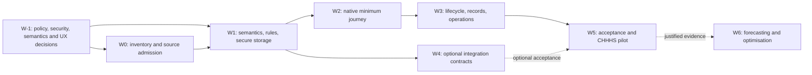

# Executable CareOps Medical Job Planning integration plan

**State:** all implementation tasks open unless explicitly evidenced in a later dated receipt. The planning package is source-only. **No authorised tenant, live industrial policy, approved staff data, native deployment, CI pass or production release is asserted.** Keep existing PRs, module tracks and native object owners intact; refresh `main`, pending PRs and qualified source before changing anything.

## Dependency graph and gates

**Critical path:** W-1 (design decisions, with any unresolved native/site permissions explicitly deferred) -> W0 -> W1 -> W2 -> W3 -> W5. W4 adapters are independent from core MVP; their deferral is **not** a new MVP release blocker. No native action solely for documentation, no production resources without business/security authority.

| Gate | Evidence required | Explicitly not proof of |
|---|---|---|
| G-1 Pre-implementation | W-1 decision evidence: industrial applicability and clause matrix, storage/ACL comparative ADR, strict-input defect reproduction, negotiation workflow, semantic contract proof, identity trust model and first vertical-slice acceptance; explicit unknowns carry forward only where tenant qualification is required | Adopted industrial policy, validated SharePoint tenant or native deployment |
| G0 Source permission | Reviewed licence/rights, source manifest and privacy scan, reproducible standalone source tests, public inventory and track reconciliation | Native app, deployed flow, rule authority |
| G1 Domain correctness | Reviewed data model and rule edition contracts, deterministic fixture parity, state-machine and concurrency/security reference tests | CHHHS policy adoption or physical ACL |
| G2 Native minimal journey | Actual clean dev solution import and complete create/submit/review/approve/retrieve flow with authenticated ACL, ETags, receipts and full readback | Live production go/no-go |
| G3 Lifecycle and records | Scheduled activation/review, policy migration, no-change attestation, issued records, exception recovery, retention/privacy/accessibility tests | Every optional integration enabled |
| G4 Optional adapter | Contract/schema tests, owner approval, complete native provider/consumer readback, negative/absence tests, controlled rollback per selected adapter | Automatic permission to activate siblings |
| G5 Operational use | Adopted industrial and delegation policies, security/records/privacy/industrial governance signoff, limited pilot, observed benefits, documented rollback and production authority | Generic transferability to other tenants |
| G6 Optional optimisation | Independent evaluation/baseline, aggregate source completeness, privacy and measurable benefit | Individual employment or competency determination |

## W-1 — pre-implementation decisions (source-only first; no tenant write)

[Decision and evidence contract](pre-implementation-decisions.md) defines **MJP-P01–P10**, all initially **Open**. These are 10 granular tasks in the existing Conductor programme, not a parallel project. Technical tasks may proceed on fictional examples while native entitlement, policy adoption and site-specific physical ACL checks remain unverified; **no operational rules or native source activation** may proceed before their applicable decision gates.

**W-1 exit G-1:** release-blocking unknowns are either resolved by source-level evidence or clearly attached to later G2/G5 as qualified native/industrial obligations. No private credentials, personnel records, tenant IDs or real enterprise exports in Git.

## W0 — reconcile, qualify and admit source (source-only)

| Task | Dependencies | Deliverable and exit criterion | State |
|---|---|---|---|
| MJP-001 | None | Refresh current CareOps main, open PRs, `portfolio/repos.json`, parent .gitmodules, `modules/careops-workforce`, governance tracks and owners; select no duplicate live workforce module | Open |
| MJP-002 | 001 | Verify 0.4.2 ZIP SHA256 `922c29f0364c7e1a0d61e4d0ba0a87f5cb28416c1f143758577404ff615626a7`, all archive file hashes, creation/provenance/Apache-2.0 compatibility, dependencies and contributor rights; preserve original bytes only in private reviewed staging if restricted | Open |
| MJP-003 | 002 | Run public-source/secret/privacy/personnel scan; classify every file and reject source that violates public CareOps boundary; preserve source manifests and non-public recovery outside Git | Open |
| MJP-004 | 001–003 | Record module naming ADR and ownership, proposed `modules/careops-medical-job-planning` path; preserve existing independent Workforce BI feed, model and source locks | Open |
| MJP-005 | 002–004, G-1 source/rights decisions | Admit *reviewed* source with correct provenance/licence notice, semantic delta and source release, or document specific blocker; do not copy `state-receipts` as unqualified current evidence | Open |
| MJP-006 | 005 | Create standalone .careops/module.json, AGENTS.md, module README, isolated build/test profile and requirement↔code traceability | Open |
| MJP-007 | 005–006 | Reconcile `portfolio/repos.json`, module catalog, README architecture, `portfolio/power-platform-alm.json`, `PUBLIC_SOURCE_FILES.json` and CI selectors in one reviewed PR; new source status is **integrated source only**, never operational | Open |
| MJP-008 | 005–007 | Run independent clean-checkout and parent targeted tests/security/inventory checks; release exact head only if all required checks passed; demonstrate rollback of source admission | Open |

**W0 gate:** G0. Source rights/attribution and PUBLIC_SOURCE_FILES provenance are blocking. Do not claim source admission on the basis of this *planning* PR.

## W1 — canonical model, rule authority, secure persistence design (local work)

| Task | Dependencies | Deliverable and exit criterion | State |
|---|---|---|---|
| MJP-101 | W0 | Versioned canonical entities for practitioner, position, appointment, service assignment, contract/instrument, plan head/version/session, approved service demand, observed work and external source; no establishment-versus-plan conflation | Open |
| MJP-102 | 101 | Explicit grains/keys, temporal model (effective/observed/issue/as-of/UTC), relationship cardinalities, many-to-many assignment and immutable versions; migration test from v0.4.2 | Open |
| MJP-103 | 101–102 | Reconcile 20 logical Lists + library vs four-list CAS subset; for each create cardinality, indexing, access cohort, retention, capacity, volume, archive and disaster recovery model before selecting physical SharePoint design | Open |
| MJP-104 | 101–103, MJP-P01–P02 | Industrial policy interpreter with signed-off, source-qualified effective dated rule packs; mark existing fixed anchor, CST rate, 0.5-hour tolerance and annualised inclusion as **synthetic**, not operative until accepted | Open |
| MJP-105 | 104, MJP-P04 | Build deterministic fixture matrix for classifications, FTE, industrial arrangements, cross-month/fortnight, leap-day, part-time, annualised modes, rounding and CST; human industrial adjudication on disputed cases | Open |
| MJP-106 | 101–105, MJP-P05 | Formal state machine and transition table incl delegated/acting roles, no-self-approval, stale grant, reject/return, no-change review, future activation, policy change and exceptions | Open |
| MJP-107 | 101–106 | Versioned core JSON Schemas, canonical hashing, idempotency, operation/key uniqueness and source version mapping; breakage blocked by explicit compatibility tests | Open |
| MJP-108 | 103,106–107 | Model SharePoint CAS saga, staged artifacts, exact ETag/412, Retry-After, abandoned operation reconciliation, permission revocation and event ordering; test synthetic faults/crashes | Open |
| MJP-109 | 101–108, MJP-P04, MJP-P06 | Repeat synthetic suite under exact parent Python pin, install all test dependencies (including Hypothesis), add property/stateful/metamorphic/mutation tests as compatible, static type/lint/security and negative privacy tests | Open |
| MJP-110 | 101–109, MJP-P03 | Assess scale/indexes/unique ACL count and security threats with measured synthetic workloads; freeze one coherent v1 domain contract and G1 receipt, with all policy authority unknown until signed off | Open |

**W1 gate:** G1. A policy owner must separately sign off rule interpretations before the values are used operationally, regardless of local tests.

## W2 — independently functioning native minimum journey (requires development tenant)

| Task | Dependencies | Deliverable and exit criterion | State |
|---|---|---|---|
| MJP-201 | W1, MJP-P03, MJP-P07 | Confirm actual development/test environment, named native owner, managed/unmanaged solution route, signed-in maker identity, licences, DLP, sites, groups and service connection permissions; read-only capability inventory first | Open |
| MJP-202 | 201 | Dry-run-first idempotent approved SharePoint provisioner and exact field/internal-name/index/permissions readback; reversible and non-destructive drift handling; no broad production ACLs | Open |
| MJP-203 | 201–202 | Implement physically enforceable draft, service review, delegated approval, operation and issued-library access, with direct-list/REST URL negative access and historical revocation tests | Open |
| MJP-204 | 201–203, MJP-P09 | Rebuild nine reference screens in actual Canvas Studio as justified, export authoritative source and accessible read/edit/save/compare; never label hand-authored YAML a .msapp | Open |
| MJP-205 | 202–204 | Implement authenticated server-side `submit` flow with exact hash, idempotency, ETag CAS, version staging and recoverable receipt; prove duplicate and 412 conflicts live | Open |
| MJP-206 | 203–205, MJP-P05, MJP-P07 | Implement minimal accountable consultation/clinical/industrial/delegated-review paths as permitted by adopted role policy; every action server-verifies identity, current delegation and submitted hash | Open |
| MJP-207 | 205–206 | Issue an immutable approved version/evidence link and separately schedule future activation; keep preview/approval/issue/active states distinct; verify previous-version retrieval | Open |
| MJP-208 | 204–207 | Actual clean dev import from a solution-aware export with exact connection refs/environment variables; verify all app/flow bindings and native readback; document install/upgrade/remove/recovery | Open |
| MJP-209 | 201–208, MJP-P09 | End-to-end fictional practitioner->review->delegated approval->approved record retrieval, unauthorised direct URL denial, duplicate/retry/throttle, actor spoofing and restart tests | Open |

**W2 gate:** G2; no native gate waived by source-only scripts. No live practitioner records until security/privacy and local governance requirements authorise them.

## W3 — full lifecycle, records, safeguards and operability

| Task | Dependencies | Deliverable and exit criterion | State |
|---|---|---|---|
| MJP-301 | W2 | Approved review obligations, fixed or adopted alternative anchoring, review due sweep, no-change attestation and exclusion/cancellation controls; test policy changes after issuance | Open |
| MJP-302 | W2 | Future-effective scheduled activation, position/contract/assignment change triggers as *review signals*, duplicate prevention and controlled supersession; no backdated silent state rewrite | Open |
| MJP-303 | W2 | CST displacement/recovery recorded as separately evidenced events, with coded reasons, rejected/returned exception governance and reconciliation | Open |
| MJP-304 | W2,301–303 | Replace all ten inert WDL blueprints with selected functional solution-aware flows only where independently justified; do not send notifications by default | Open |
| MJP-305 | W2 | Apply controlled Word/SharePoint document templates, versioned approved plan export, immutable references, retention/hold, issuance validation and exact historical access | Open |
| MJP-306 | W2,301–305 | Operator queue and read-only monitors (prepared, committed-unfinalised, throttled, denied, partial pages, activation/policy review, broken export); manual recovery with audit | Open |
| MJP-307 | 302–306 | Physical security and accessibility tests incl mobile/tablet, role grant/withdrawal, copied URLs, keyboard/screen reader, native records permissions, outage/restore and 5-year volume | Open |
| MJP-308 | 301–307 | Production-safe telemetry: outcomes, error codes, retries, quality and non-sensitive timings; no clinician plans/free-text/UPNs in public traces or report monitoring | Open |
| MJP-309 | 301–308 | Approved manual fallback, outage playbook, export/retention, rollback/restore, operator handover and release evidence; record G3 or exact unresolved blockers | Open |

**W3 gate:** G3; no automatic email sending, no production deployment and no policy enforcement merely because native development tests pass.

## W4 — optional CareOps interoperability (each adapter independent)

Implement [integration-contract.md](integration-contract.md) and [machine-readable v1 schema](contracts/envelope.schema.json); one interface owner and an independently disableable adapter per service. Missing providers do not fail W2/W3 acceptance.

| Task | Dependencies | Deliverable and exit criterion | State |
|---|---|---|---|
| MJP-401 | W1, MJP-P06 | Validate all v1 envelope/payload schemas and synthetic positive/negative fixtures; compatibility matrix and schema digest; no real identities | Open |
| MJP-402 | 401 | Build common transport/auth/scope/idempotency/quality/dead-letter conformance harness; one owner/correlation/consent-purpose/rollback receipt per adapter | Open |
| MJP-403 | 402 | PPG `MJP-POL-01`: edition/effectivity read-only policy reference; local approved snapshot fallback; reject withdrawn/unadopted rules for new approvals | Open |
| MJP-404 | 402 | Approve `MJP-APP-01/02`: version+hash-locked request/result, independently verified delegation and anti-self-approval; no autonomous status write | Open |
| MJP-405 | 404 | Optional Decisions path: agree *formal decision* record authority, source-qualified evidence and preventing duplicate decision registers; test absent Decisions and provider mismatch | Open |
| MJP-406 | 402 | Process `MJP-PRC-01`: append-only pseudonymous lifecycle event projection, OCEL 2.0 compatibility only if proven relevant, late/out-of-order/deduplication tests | Open |
| MJP-407 | 402, MJP-P08 | Workforce BI `MJP-WRF-01`: versioned period/service/measure aggregate, separate actual-vs-planned source, complete/suppressed/missing data and small-cell protections | Open |
| MJP-408 | 407 | Reconcile optional Workforce BI projection to its **existing** PBIP/TMDL/PBIR and 66 private feeds; define a separate reviewed feed/semantic extension, private source binding and report/RLS parity; no silent source alteration | Open |
| MJP-409 | 402 | Costing/Finance `MJP-CST-01`: source-qualified planned hours and external wage/FTE/price reference with uncertainty; do not assert plan hours are actual payroll cost | Open |
| MJP-410 | 402 | Sim `MJP-SIM-01`: synthetic/deidentified scenario schema, reproducible seed, optional offline route; no operational writeback | Open |
| MJP-411 | 402 | External HR/position/contract/roster `MJP-EXT-01`: approved source agreement, read-only verified refs, effective dates, denied/stale handling and reconciliation, no new HR master | Open |
| MJP-412 | 403–411 | Test every enabled adapter for provider absent, stale/partial, schema mismatch, unauthorised scope, repeated events, 429, privacy, no hidden premium dependency, independent uninstall/rollback; G4 for **each**, not whole suite | Open |

**W4 gates:** G4 independently per adapter. No core MVP release dependency on a BI workspace, Power BI PPU, Fabric, Dataverse, AI, other modules or optional notifications.

## W5 — acceptance, risk evaluation and controlled rollout

| Task | Dependencies | Deliverable and exit criterion | State |
|---|---|---|---|
| MJP-501 | W0–W3 | Reconcile parent CI, selected code standards, dependency/SBOM licence, vulnerability, Gitleaks/Presidio and exact current-head actions; no blanket skip/xfail, no pretend green for billing refusals | Open |
| MJP-502 | W3, MJP-P01–P02 | Record authorised industrial instruments, workforce policy editions, delegated approval matrix, practitioner consultation requirements and HR/IR adjudication; no fabricated Queensland Health compliance claim | Open |
| MJP-503 | W3 | Formal privacy assessment, records retention, classification, role matrix, DLP, legal hold and service identity/SharePoint security approval in target environment | Open |
| MJP-504 | W3, MJP-P03, MJP-P07 | Clean test-environment install and behavioural tests for all nine UI screen routes and required flows; site/index/URL ACL, 412, 429, idempotency, crash replay, backup, restore and accessibility evidence | Open |
| MJP-505 | 502–504 | Reconciliation of outputs to approved source policies, source version history, issued records, contract/FTE references, industrial exception cases and operator playbooks | Open |
| MJP-506 | 502–505 | Explicit pilot scope, named approvers, user groups, support/rollback, help material and success measures; no pilot access granted from this source PR | Open |
| MJP-507 | 506, MJP-P09 | Limited authorised pilot with measured baseline and follow-up: hours to complete/review, approval timeliness, rework, security incidents, error counts, net admin effort and staff usability | Open |
| MJP-508 | 507 | Analyse unintended administrative burden, inequities, service coverage, workload shifts, incomplete data and errors with pre-specified baselines; publish no causal staffing benefit without design | Open |
| MJP-509 | 501–508 | Source+native+operational gate package, permitted stage promotion, recorded production go/no-go, rollback/restore and protected PR/main verification; G5 only on documented approval | Open |

**W5 gate:** G5. Source or development success does not establish CHHHS approval.

## W6 — frontier extensions after demonstrable benefit (not core gates)

| Task | Dependencies | Deliverable and exit criterion | State |
|---|---|---|---|
| MJP-601 | W5 | Prove independent approved establishment vs plan vs delivered service coverage measures and verified, missingness-aware time series | Open |
| MJP-602 | 601, W4 selected | Analyse FTE and service capacity, staffing mix and opportunities with service/clinic constraints; explicit uncertainty and human review | Open |
| MJP-603 | W5 | Evaluate Dataverse optional deployment only against quantified SharePoint ACL, scale, transactional or lifecycle gaps and full cost/TCO/licence/security evidence | Open |
| MJP-604 | W5 | Reproducible synthetic scenario optimisation and bias/equity tests, no automated employment actions or workforce performance judgments | Open |
| MJP-605 | 601–604 | Mature CI/quality verification with quality thresholds and actual benefit vs baseline; deliver independent canary/rollback receipts | Open |

## Traceability and quality matrix

| Requirement group | Deliverables | Minimum evidence |
|---|---|---|
| MJP-R01, R13–15, R38 | W0,W2 | Standalone clean install and no sibling/premium dependency |
| MJP-R02–05, R31–36 | W1 and W4 | Canonical temporal schema and industrial rule calculation fixture parity |
| MJP-R06–09, R12, R35 | W1–W3 | Concurrent/stale action tests, exact ETag, irreversible issued version, immutable review |
| MJP-R10–11, R16–20, R33–34, R37, R40 | W2–W5 | Direct URL ACL, revoked delegation, privacy/records/accessibility, no unauthorised sends |
| MJP-R21–24, R39 | W4 | Aggregate data contract and optional adapters with owner and disclosure gate |
| MJP-R25–26, R41–42 | W3,W5 | Scale, monitoring, baseline/effort benefit and recovery |
| MJP-R27–29 | W6 | Separately justified optional platform and forecasting improvements |
| MJP-R30 | All | Explicit exclusion verified with source and deployment checks |
| MJP-IC-01–12, MJP-P01–P10 | W4/W5 | Every enabled adapter's synthetic + actual native conformance receipts |

## Execution instructions and stop rules

1. **Pre-implementation source gate:** execute MJP-P01–P10 first. No synthetic formula, negotiated status, source-store or connector identity assumption becomes business authority. Use Playwright for newly authored Power Platform UI end-to-end tests; Microsoft's legacy Test Engine was deprecated April 2026. Prove delegated/fully paged reads on synthetic datasets exceeding default Power Apps delegation limits and representative five-year volumes.
2. Before each change, read CareOps AGENTS.md, exact parent `.careops/module.json`, docs/ci-delivery-contract.md, existing owner tracks and current PRs. Follow Conductor implement -> review -> fix -> verify; preserve the parent Conductor gitlink, do not create a separate approval bureaucracy.
3. Deliver local, testable increments first. Prefer contract tests before implementing behavior; reuse existing security and targeted-test infrastructure. Integrate whole-source state only after G0 and do not expose private artefacts.
4. Keep public source inventory and module catalog in sync with actual committed files and materialisation status. **This planning PR only registers a proposed track, not the new module.**
5. All real M365/SharePoint provisioning starts with read-only capability checks and an explicit named site/owner approval. No unauthorised tenant writes, flow activation, sharing, mail send, industrial policy adoption or production cutover.
6. Never claim completed, passed, imported, enabled, merged or deployed without an exact commit, test run, environment, provider identity and applicable owner signoff. On missing access/licence/CI billing, record `blocked/unverified`, not `passed`.
