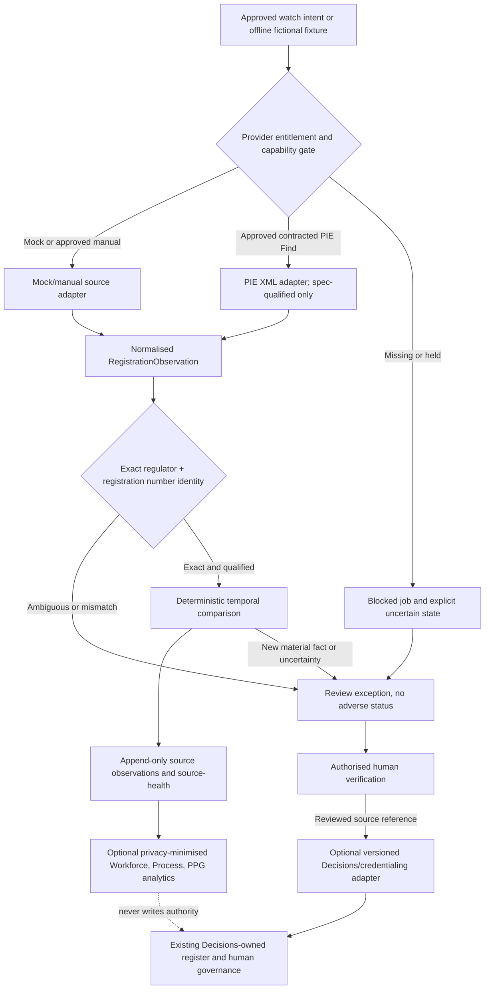

# Registration assurance integration — technical design and mapping

**Status:** source/architecture candidate only, 13 November 2026. This document elaborates the [binding contract](../../../docs/credentialing/registration-assurance-integration-contract.md) and [MoSCoW requirements](requirements.md); no native component is declared present by this design.

## A. Ownership-first architecture

The optional `modules/careops-registration-assurance/` source is a proposed new bounded capability, **not** a second practitioner register. Its native solution only owns monitor configuration/approved watch intent, source-health, immutable observations and review candidates. A minimal standalone manual/mock release remains usable when Decisions, premium HTTP, PIE or AI is absent. Watch list data is restricted staff data even when not an authoritative register. Avoid cross-module Dataverse lookups from the standalone core; join only in the separately deployed Decisions adapter.

## B. Source-to-target disposition

| v3.1 archive element | Target/disposition | Reason / required test |
| --- | --- | --- |
| `ahpra-monitoring-repo/config/providers.json` | **Refactor** into per-provider capability and legal qualification manifests | No assumption that an OAuth2/JSON PIE switch is correct; versioned contract policy with disabled state |
| `ahpra-monitoring-repo/docs/PIE-SWITCH.md` | **Replace** with spec-driven onboarding/admission contract | Public PIE docs say XML and publish no actual auth contract; Alerts browser-only |
| `ahpra-monitoring-repo/test/mock-ahpra/mock_responder.py` | **Retain concept**, strip public-network assumptions, test as fictional double | Positive/error/malformed/duplicate/stale/identity fixtures, no real practitioner data |
| `ahpra-monitoring-repo/scripts/build_*.py` and `validate_*.py` | **Repair/selectively reuse** after licence/source provenance | Remove absolute author paths, deterministic no-network generation, generated artefact semantic diff |
| `ahpra-monitoring-repo/canary/*` | **Redesign** as provider-health/contract-drift telemetry, optional, disabled | Canary cannot establish registration or substitute for permitted live source test |
| `ahpra-getpredictions-bootstrap/*` | **Historical reference** only | Name-suggestion endpoint cannot verify status; Excel is not an operational register |
| `ahpra-watchlist-notifications/powerautomate/*` | **Decompose** into stopped solution-aware flows, restricted watch and outbox | No import+enable, no direct email, no uncontrolled duplicates |
| `ahpra-watchlist-notifications/logicapps/*` | **Optional contracted HTTP adapter** after Microsoft licensing and API verification | Do not run alongside Power Automate as a second owner without explicit deduplication |
| `ahpra-watchlist-notifications/sharepoint/list-schemas.json` | **Map** only to monitoring-owned state/approved evidence | No copy of practitioner master or editable Dataverse mirror; retention/privacy controls |
| `ahpra-monitoring-repo/diagrams/*` | **Reuse after reconciliation** as non-authoritative diagrams | BPMN diagrams do not prove implemented platform/review gates |

No source is copied into CareOps until ownership, rights, licence, dependency/security and public-source review are settled. If the source cannot be licensed or admitted, independently implement the contractual behaviour using clean-room code and fictional tests.

## C. Typed boundaries and events

Canonical cross-module data: [RegistrationObservation envelope schema](registration-observation.schema.json). Schema semver major version 1. Internally, maintain separate types:

1. **WatchIntent:** source-qualified watch ID, approved purpose, assigned operational owner, jurisdiction/regulator, exact registration number when known, selected permissioned provider, activated/disabled, next due time. No inferred staff employment.
2. **CheckJob:** job and correlation IDs, requested provider, active contract version, start and lease, retry budget, deadline, state (`queued/running/succeeded/blocked/failed/unknown_delivery`), next retry, review/exception owner.
3. **ProviderResponse:** transport status, schema version, provider as-of, fetch time, payload digest, restricted evidence reference, source health, capability ceiling. Raw content stays in approved restricted storage only if permitted.
4. **RegistrationObservation:** immutable normalised factual fields; `sourceHealth`, `identityState`, `registrationStatus`, `conditionsIndicator`, date, mapping version and source metadata. This is a *source observation*, not a register status.
5. **ReviewException:** stable case ID, observation/input digest, reason code, priority, previous disposition, source conflicts, evidence references, human reviewer, decision time, superseding history. A case is not a credentialing restriction.
6. **AdapterReceipt:** exact observation/version, permitted purpose, consumer ID/version, correlation, idempotency key, accepted/rejected/held result, durable receipt and replay rules. Never reuse an older receipt as current entitlement.

Only an exact registration number and approved identity mapping may connect an observation to the existing Decisions-owned practitioner. Provider-unique suggestion IDs and names do not create identities. Do not write back `RegistrationObservation` as the effective Decisions registration without an authorised owner action.

## D. Temporal and evidence state machine

Four independent axes MUST be represented:
- **Acquisition:** `healthy / blocked / rate_limited / transport_error / schema_drift / stale / unknown`.
- **Identity:** `matched / candidate / ambiguous / unresolved`.
- **Regulator signal:** `registered / not_registered / suspended / cancelled / unknown`.
- **Review:** `not_applicable / pending / reviewed / superseded`.

The signal is meaningful only within the source's capability ceiling and source time. A successful autocomplete HTTP response has `discovery_only`, not `qualified_regulatory`; an absent suggestion or WAF response does not generate a verified adverse change. An adverse source signal generates a review exception, preserving the original evidence and independently checked current status. Human governance determines any downstream action through existing law/policy/delegations. Expiry is a date field, not a state transition to deregistration.

Comparison keys: provider-qualified regulator+registration number+field identity; source revision/as-of; normalised semantic hash; approved rule version. Two *different observations* of the same fact may be recorded, but an identical job replay MUST be idempotent. Out-of-order as-of timestamps cannot replace a newer verified projection without explicit review; a later correction produces a supersession link. Preserve bitemporal `observedAtUtc` versus `asOfUtc`, plus review decision timing.

## E. Native Microsoft implementation variants

| Profile | Source-only/standalone behaviour | Tenant prerequisites |
| --- | --- | --- |
| Synthetic/offline | Reproducible Python pure logic + schema fixtures + mock/manual records with no real data | GitHub/local Python 3.15.1; no Microsoft tenant, AI, credentials or network |
| Standard-M365 manual | Restricted SharePoint monitoring state, standard-connector import and a human verification queue; **no automated AHPRA HTTP polling** | Explicit site permission, approved Lists/library, DLP/records and service owner; no hidden premium dependency |
| Credentialing native | Separate managed solution with Decisions-owned Dataverse linked references, native server-side policy protections, Power Apps reviewer surface, resumable workers | Full Dataverse entitlement, approved environment, source-specific permissions, actual PAC/solution validation |
| PIE automated adapter | Contracted XML Find transport with hardened parsing, normalized response, permissioned health checks and explicit failures | AHPRA contract, issued technical spec, auth/key management, approved HTTP/Logic Apps licensing/runtime, integration testing |

Azure Logic Apps and Power Automate HTTP routes are **alternatives** to qualify, not both mandatory active writers. No AHPRA endpoint is silently polled by a template. Secure secrets, re-check entitlements, DLP, sign-in, export, audit and regulated hosting at native qualification. If an official API is not available, the accepted first release is the limited manual or synthetic workflow — not an automated scraper.

## F. Optional consumer integration contracts

- **Decisions:** read-only verified source reference + explicit reviewer disposition and currentness. Only existing protected native transaction boundary may change register/SoCP; neither a red severity flag nor a flow's `approved=true` is authority.
- **Workforce:** permitted aggregates of workforce watch coverage/renewal verification and unknown/stale counts with denominator/period, never a new employment claim or practitioner-level public dashboard.
- **PPG/accreditation:** exact edition/version of regulatory standard, policy and accreditation element with evidence reference; monitoring completion is process evidence only, not overall compliance.
- **Process:** privacy-minimised `attempted`, `blocked`, `reviewed`, `reconciled` event timings; no identifiable person or raw conditions in generic event streams.
- **Costing/Finance:** accepted counts, denominators, activity time/cost and licence assumptions with provenance; no staff-level accounting writes.
- **Incidents/RIMS/Clinical Hub:** out of MVP; require a separate supported purpose and consumer contract. No automatic safety allegation or research linkage from registration observation.

## G. Privacy, threats, recoverability and review

Threat models include homonyms/registration-number collision, prompt/HTML/XML injection, malformed DTD/XXE expansion, provider contract drift, account takeover, token leakage, replay, delayed/wrong-order messages, privilege bypass via direct API, exposed document links, reactivation of superseded adverse status, inaccurate employer membership and mistaken email recipient. XML parser MUST prohibit entity resolution and untrusted external access. Use authenticated authorisation on APIs and storage, not UI-only hiding; test direct links and data exports.

Keep source payload retention and audit/record retention **distinct from backup**. A same-tenant List is not an independent tenant disaster-recovery plan. After restore, quarantine outbound integration, reconcile source/decision history and idempotency/outbox, revalidate permissions/consents and require operator release. Regulator source failure leaves the existing credentialing register intact with an explicit verification-needed state. All email paths default disabled and require a specific separate approval.

## H. Interface/version compatibility test expectations

Test exact and invalid schema major versions, fixture-based XML/JSON input, provider mismatch, stale/absent data, identity ambiguity, duplicate replay, corrected evidence, contradictory sources, no installed sibling, offline/blocked provider, old provider response arriving late, concurrent native update, disabled notification and restore/outbox restart. Positive source-only tests do not establish native acceptance. Runtime and release evidence are recorded per G0–G3, not inferred from generated WDL or green CI.
