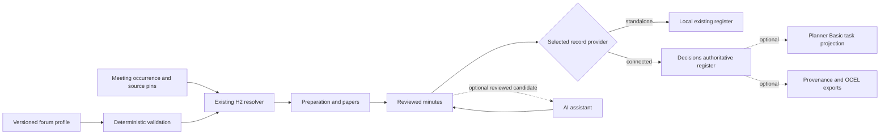

# Architecture and contracts

## Source-only compiler
`scripts/meeting_blueprints.py::compile_meeting_portfolio` accepts a nonempty list (max 64) of strict profiles: `forum_ref`, `profile_revision`, `display_name`, `register_ref`, `template_ref`, `agenda_sections`, `control_keys`, and `capabilities` (only `prepare`, `compare_calendar`). Returned review-only plans are sorted by forum identity, content-hashed, never write-enabled and have no tenant bindings. Duplicate forum IDs, unrecognised dependencies and unknown keys fail closed. This is a lightweight portfolio plan over existing H2's richer effective-dated profile/occurrence/source resolver; it is **not** another H2 authority or a second record store.

## Native provider interface — pending
Adapters must expose `read_forum_profile`, `read_occurrence`, `read_source_revisions`, `read_authoritative_actions` and reviewed `propose_update`, with stable keys `(forum_ref, occurrence_ref, record_id, revision)`. Only a qualified native writer may conditionally apply proposals. One active provider per logical governance record. Preserve native IDs, provenance, permissions and history. Use existing SharePoint native forms/Lists/standard flows and maintain Word/manual fallback; optional Dataverse/Copilot adapters do not belong in the core.

## Automation first
Deterministic preflight (missing paper/version, incomplete agenda, stale authority), meeting packs from controlled templates, carry-forward, calendar drift, duplicate/replay detection, reminder **views** and task/status projections should precede any model. Model assistance may only produce cited proposals with human review, and must be benchmarked for omitted conditions, dissent, negation, invented owner/date and reviewer rework. No autonomous circulation or email.

## Validation boundaries
Source compiler/test evidence does not establish deployed flow graph, signed release, model correctness, record authority, user access or benefit. Reuse the existing H2 native workstream for actual two-forum, operator, concurrency, rollback and complete-source readback acceptance.

## Read-only Decisions projection — source implemented

`scripts/meeting_register_projection.py::project_register` operates on a bounded list of explicit forum IDs and a caller-supplied complete metadata snapshot of governance records. The contract requires `forum_ref`, `record_id`, `occurrence_ref`, `kind`, `status`, `version`, `source_ref`, `source_revision`, `owner_ref`, `due_date`, and `completion_evidence_ref`. Identical IDs can occur in different forums; duplicate `(forum_ref, record_id)` within a forum are refused. Unexpected fields, invalid dates, unsupported states, missing source identity and missing completion evidence in reported-complete/resolved states are refused. Results sort both forums and records before computing their deterministic digest, return count summaries, and explicitly mark source authentication, snapshot completeness and authority **unverified**.

These are metadata invariants, not a native provider: no List authentication, full-page fetch, ETag comparison, record owner verification, signed approval or write is performed. A `resolved` row with a reference is still a **caller assertion** until a separately qualified Decisions/local provider validates the relevant decision. Preserve the existing F15 reviewed lifecycle as the owner of authoritative transition rules. Use this projection for read-only workspace views only after native read scope and access are separately qualified.
