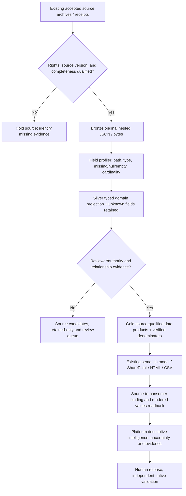

# Design — retain every useful field without destroying authoritative reporting

## No-premium mechanism
- Core: original source's accepted native archive, standard-connector SharePoint JSON + JSON Schema/manifest, and separately usable offline source processors.
- Consumer: Power Query Import, existing PBIP/TMDL where owned, public/suppressed HTML or CSV. Do not require Fabric capacity, Copilot, paid model connectors or premium HTTP actions.
- Optional: local SQLite/Parquet, tested CPU NLP, ML, or independently deployed Fabric/XMLA/Copilot provider; no add-on action in mandatory core.
- File/profile implementation: `portfolio-scripts/rims_retained_field_utilisation.py`, `rims_coverage_rollup.py`, existing `rims_field_coverage.py` and retained PubMed adapter.

## Important boundaries
No user-facing report uses a source field merely because a field name appears in TMDL. Source-to-consumer is only **declared** until exact current report visual, measure, scorecard and RDL readback plus data-parity tests. Do not confuse evidence of source capture with live Gold acceptance. Field paths may themselves contain confidential keys; private source profiling must stay private and published rollups must aggregate or suppress small cells.

## Review and performance
Bound source traversal depth, distinct paths and record count; fail closed on unknown JSON types, duplicate mapping, conflicting retained/excluded classification, untrusted source hash, source-population drift and missing response. Profile memory over the accepted archive in bounded batches rather than loading huge files into a single cloud flow.
