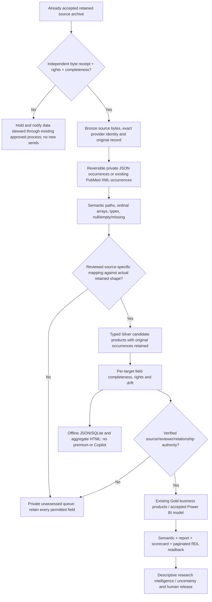

# RIMS existing-data exploitation — full JSON and typed consumer track

**Date:** 11 November 2026  
**Owner:** Existing `rims_full_data_utilisation_20261110` Conductor workstream.  
**State:** Source implementation partial; actual retained-data, native Gold/Platinum and Power BI acceptance remain open.

This is not a new source collector, separate authoritative register, additional schedule or replacement for the 1,344-record/23-indicator previously accepted RIMS model. Six available mapping recipes are deliberately **candidates**. All 17 existing source routes appear in the [source-map manifest](../../../portfolio/rims/maps/existing-source-map-manifest.json); the remaining eleven must be qualified against actual retained source shapes before mapping.

## Inputs, authoritative ownership and contracts

- Existing accepted source bytes and exact independently pinned source receipts in the original private custody; no production/source data copied to Git.
- [17-source adoption catalogue](../../../portfolio/rims/existing-source-adoption.json), the existing 136 source tasks and recorded native publication/Power BI acceptance.
- [Private full JSON occurrence contract](../../../portfolio/rims/contracts/private-json-occurrences.schema.json) and [reversible projector](../../../portfolio-scripts/rims_json_occurrences.py): every array/object/scalar/null with JSON Pointer ordinal and semantic paths. Original bytes remain the byte oracle.
- [Source mapping contract](../../../portfolio/rims/contracts/field-product-map.schema.json), [private product contract](../../../portfolio/rims/contracts/private-field-product.schema.json) and [typed source projector](../../../portfolio-scripts/rims_source_products.py): mapping requires independent review, stable source/domain/version, exact types and cardinality; missing remains distinct from null.
- [Retained batch/receipt contract](../../../portfolio/rims/contracts/retained-json-batch.schema.json) and [batch processor](../../../portfolio-scripts/rims_batch_products.py): checks registered source, accepted receipt, exact record count and byte SHA before private transformation.
- [Archived Power BI baseline](../../../portfolio/rims/powerbi/archived-semantic-model-inventory.json): Publication 51 columns/25 measures and GrantsRegistry 32 columns/3 measures in *archived source*, NOT present-day tenant/visual usage.
- [Coverage HTML renderer](../../../portfolio-scripts/rims_coverage_report.py): offline non-premium domain-level accounting; mapped, retained, excluded and unassessed are separated; this is not a research-impact dashboard or credential to publish.

## Design

The projector deliberately does not require a Graph user directory, Copilot, Dataverse, HTTP premium connector, Fabric capacity or direct SQL service. It does **not** write SharePoint files or change the deployed flows. The existing accepted SharePoint file writer/manifest and solution-aware native lifecycle retain ownership.

## New executable tasks

| ID | Priority | Executable scope for a local agent | Test or evidence / exact exit | Source status |
|---|---|---|---|---|
| MX-J01 | Must | Read one original accepted raw JSON record and independent byte receipt; confirm source ID in the existing 17-source catalogue | Retained SHA, rights, source row identity and observed generation privately pinned; no API call | Native/private pending |
| MX-J02 | Must | Expand a complete JSON record into original ordered and semantic field occurrences | `test_rims_json_occurrences.py`: nested, >10-array index, null/empty, duplicates, no lost JSON values | Implemented source |
| MX-J03 | Must | Reconstruct the original nested value and reject changed/duplicate/gapped path | Original semantic SHA matches reconstructed JSON and original byte SHA stays attached | Implemented source |
| MX-J04 | Must | Select one reviewed source-specific map; reject unknown source, mismatched type and scalar-on-repeated values | `test_rims_source_products.py`; source fields retained verbatim for review | Implemented source |
| MX-J05 | Must | Apply one independently accepted private batch, refusing incomplete/extra/duplicate records and mismatched byte hashes | `test_rims_batch_products.py`; exact accepted row set and audit flags; no report approval | Implemented source |
| MX-J06 | Must | Preserve and count every source path, including those absent from typed consumer mapping | All unmapped paths remain in private source occurrences; zero silent source truncation | Implemented source |
| MX-J07 | Must | Qualify the **actual** provider JSON envelope, field types, rights and permissions before applying a map | One retained raw/typed readback and matched semantic paths per source, no guessing | Await original private archive |
| MX-J08 | Must | Implement typed field tests per provider for authors/affiliations, study outcomes, corrections, related outputs, grants and organisation hierarchy | Versioned provider-specific fixtures and missing/null/repeated cases, zero inferred employment or award | Six candidate maps; rest pending |
| MX-J09 | Must | Reconcile the 17-source product outputs with the *actual* existing Silver/Gold ledger, 1,344-key canonical source and prior accepted source populations | Existing human review, ETags, time periods, source refs unchanged; byte parity and denominator receipts | Native/private pending |
| MX-J10 | Must | Verify real semantic model `sourceColumn`, measure, dashboard, scorecard and RDL bindings for selected high-value fields | Compare exact current model to archived 51 Publication/32 GrantsRegistry columns; protect original 23 indicators | Native/model pending |
| MX-J11 | Should | Aggregate source field completeness by type and missingness for business stewards | Correct present/null/missing denominators and field-name privacy; no native usage claim | Implemented source |
| MX-J12 | Should | Render domain-level non-premium coverage HTML from existing rollup | `test_rims_coverage_report.py`: count parity, escape untrusted names, no sensitive paths/false 100% | Implemented source |
| MX-J13 | Should | Benchmark local private JSON (and optional SQLite/Parquet) on complete accepted data; partition as needed | Actual runtimes, peak memory, file size, schemas and key parity; no presumption of speed | Pending private data |
| MX-J14 | Must | Review all additions, run exact Python 3.15.1 and hosted suite, merge only after required checks pass | Conductor review, current-head CI/normal protected merge and independent native acceptance | Pending hosted/native |

For every one of the **17** registered sources, resume its existing `MX-Sxx-01..08` tasks rather than duplicating source-specific task IDs. The six candidate maps are OpenAlex, Semantic Scholar, ClinicalTrials.gov, ROR, DataCite and Crossref; all were created from documented/public API structures but **not verified against retained native envelopes**. PubMed uses its established XML path-aware consumer. DoRA, Europe PMC, OpenCitations, ARDC, ARC, NHMRC, MRFF, QGIP, GrantConnect and NIH require exact retained shape verification before mapping.

## MoSCoW reconciled

**Must:** retain every permitted original field/byte and array ordinal; identify missing/null/empty accurately; validate source and human decision authority independently; retain prior accepted 23 indicators and publication review history; prevent uncontrolled source changes, new collectors, premium core requirements and personal data leakage.  
**Should:** high-information nested provider consumers, 17-source field lineage report, source-specific quality dashboards, offline typed export and native report parity tests.  
**Could:** optional Parquet/SQLite, NLP and network/impact intelligence after validation against existing source evidence.  
**Won't now:** Trove, new source calls, autonomous data release or author/award/employee adjudication, tenant writes without exact authority, new Power BI model or replacement dashboard.

## Qualification and known limitations

Source TDD test cycle: new JSON and mapping modules initially failed until implemented; the 25-element array test exposed lexicographic ordering that was subsequently fixed. The read-only batch processor and HTML renderer were similarly exercised with fictional cases. **At least 29 focused local tests pass on Python 3.13.5** for the new modules; strict schemas and current GitHub-head native Python 3.15.1 / security-harness checks have not been qualified.

JSON numeric values parsed through Python floats may not preserve original decimal lexemes: source *bytes* are retained separately; exact financial amounts must be re-parsed from the byte source with Decimal before being promoted into a typed Funding product. This is a P0 provider-specific contract and is not complete. A 2,000-record/64 MB per-batch bound requires partitioned private processing for larger data. Mapping verification callbacks are caller-owned test seams, **not authentication providers**. Full-value products and even field names may contain personal or restricted data and remain private; HTML output is aggregate only and still requires disclosure review.

**Do not mark native, full-provider, all-field, all-domain, Power BI or Platinum completion from these source functions.**
