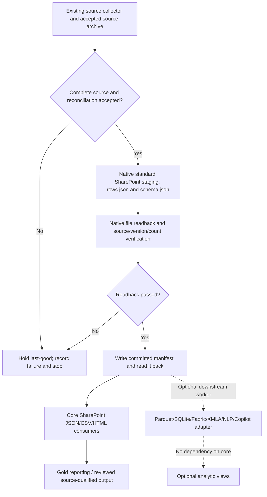

# Design — Source-to-native RIMS file-cache and optional solution architecture

## Principle
**Reuse existing completed source archive** → optionally create approved immutable typed reporting snapshots → read back → commit marker → publish stable Gold view. Operations are guarded separately from analytical code. The system must run with standard SharePoint/List/file capabilities; premium features consume snapshots independently.

## Architectural view

## Native Power Platform delivery mechanism
- Do **not** insert Python into a cloud flow. Existing solution-aware SharePoint `CreateFile`/`GetFileContentByPath` operations are the native write/readback route. The offline Python modules supply contracts, test data and verification logic.
- First read exact live flow and source connection references. Reuse qualified actions and connection refs, and replace personal target paths only after site/service-account owner approval.
- Use environment-variable definitions only for organisation-specific parameters; leave actual values out of source. PAC CLI solution unpack and pack/check, then import into a development environment with credentialed owner, run native test cases, verify last-good/rollback, promote separately.
- New child flows are appropriate only when they provide a tested runtime boundary and satisfy connector/licensing constraints. Long flow counts alone are not justification for refactoring.
- Stage path includes **source-qualified revision/run ID**; never reuse a mutable filename for a new capture. A terminal marker is written after readback, not as a promise that a future worker will complete.
- Cores have no mandatory premium connector actions in definitions. A requested premium worker is a separate solution and must be independently admitted for licence, DLP, permissions and data release. Fallback uses unchanged SharePoint JSON snapshot.

## Source contracts
- **Audit output**: `contracts/flow-admission.schema.json`; raw URL and secret fields absent.
- **Snapshot**: `portfolio-scripts/rims_file_snapshot.py`, schema in `portfolio/rims/contracts/medallion/bronze.schema.json`; authoritative native commit marker remains separate.
- **Capability**: `portfolio/rims/platform/storage-profile.json`; `rims_platform_capability.py`; default `sharepoint_json` and optional packages explicitly absent from core.
- **Flow-specific**: 36-flow register in `../rims_medallion_verticals_20261110/flow-register.json`.

## Required native negative cases
1. Incomplete or stale capture; missing page; empty but unexpected source.
2. Conflict in source/run/version/count versus readback; partial binary output; metadata mismatch.
3. Duplicate retry after uncertain CreateFile; existence check and refusal without overwriting accepted snapshot.
4. Unknown/list-internal field or unverified publication `Included`; no auto-approval.
5. 429/rate-limit, 5xx outage, connection revoked, inaccessible personal path, native flow failure.
6. Optional premium provider absent/denied: core still produces and consumes valid JSON snapshot.
7. Replay of previously issued report: no overwrite, historical issue retained, controlled reissue only.

## Power BI and offline consumers
Use an approved `SharePoint.Files` / `Json.Document` Import query that enumerates only verified committed snapshot files (schema and source identity must match); type decimal and time values explicitly; preserve periods and row denominators. Source-level M text does not establish deployed semantic model, scorecard, dashboard or paginated-report parity. Benchmark only after native accepted snapshot and model baseline are available.

## Security
No raw source ZIP, tenant addresses, personal identifiers, operational records, sensitive person/reviewer fields, tokens, or test targets in the repository. Tests create fictional flows. Parent public-source inventory must include every new file. Changes must preserve native settings/hold policies and prevent automatic email, report issue, extra schedules or new source collectors.
