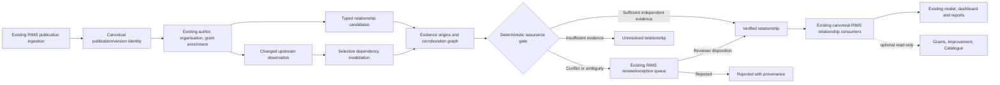

# RIMS research relationship assurance — architecture and contracts

## Pipeline and responsibility

The independent gate is **downstream of candidate generation**, separate from the existing canonical publication inclusion decision. Only relationships enter assurance; no duplicate publication, author, award or grant registry is created. Source producer and accepting authority are distinct metadata fields even where the same system physically hosts both.

## Typed relationship/evidence model — proposed version 1

**RelationshipAssertion**: `assertion_id` (stable digest of namespace/subject/predicate/object/evidence origin), `publication_key`, `subject_namespace`, `subject_key`, `predicate`, `object_namespace`, `object_key`, `direction`, `source_evidence_ids`, `status`, `status_version`, `rule_or_reviewer_ref`, `recorded_at_utc`, `effective_from`, `effective_to`, `source_snapshot_id`, `supersedes_assertion_id`. Separate stable **relationship identity** (subject/predicate/object) from versioned evidence assertions to allow multiple independent observations and later corrections. Avoid truncation-prone identifiers without a collision strategy.

**EvidenceObservation**: `evidence_id`, `upstream_origin_id`, `provider_id`, `publication_version`, `source_record_ref`, `source_revision_or_etag`, `content_digest`, `source_field_path_or_passage_ref`, `retrieved_at_utc`, `asserted_at`, `effective_period`, `identity_namespace`, `access_class`, `quality_flags`, `contradicts`. Keep sensitive full source bodies in authorised existing archives rather than public source or Power BI.

**RelationshipReview**: `relationship_key`, `expected_revision`, `disposition`, `reason_code`, `reviewer_or_rule_ref`, `evidence_ids`, `reviewed_at_utc`, `supersession_ref`, `native_receipt_ref`. Proposals are not native writes or business decisions; a reviewed disposition requires actual applicable authority. One authoritative existing RIMS relationship owner, no additional committee/approval by default.

**Review queue case**: stable identity and current input digest; material change summary, strongest supporting and contradictory origins, known/unknown scope, required human determination, previous disposition and current source/version. No repeated queue on an unchanged accepted candidate.

### Relationship taxonomy

| Predicate | Meaning | Automated admission boundary |
| --- | --- | --- |
| `authored_by` | Publication has a specifically identified author | Structured author key/ORCID/author-order evidence; name-only stays candidate |
| `author_affiliated_with` | Published author affiliation at specified publication version/date | Structured author–affiliation source and independently resolved organisation, not an assertion of employment |
| `institutional_contribution` | Organisation contributed as published author institution | Explicit author-to-affiliation linkage; publication organisation string alone remains provisional |
| `formally_partnered_with` | Documented research project/organisation partnership | Formal agreement, approved project registry or comparable independent authoritative record; coauthorship alone insufficient |
| `funded_by_award` | Publication acknowledgement linked to an actual grant award | Exact funder + normalised award number and authoritative award match; opportunity relevance never substituted |
| `relevant_to_opportunity` | Topic/eligibility may match future/current opportunity | Candidate/review relevance, never funding outcome |
| `part_of_study` | Publication is an output of a specific study | Exact study registry/publication identifier link or reviewed project evidence |
| `has_related_output` | Provenance link to dataset, software, protocol or other output | DOI/DataCite relation/type/version or explicit source; direction retained |
| `relevant_to_service` | Clinical subject related to service/programme | Controlled classification can tag topic relevance but is not evidence of local conduct |
| `led_by_institution` | Institutional lead role | Explicit author position + aligned verified author-affiliation or formal project role; keyword heuristics only candidates |

## Evidence precedence and independence

Use exact, source-qualified native publication/award/project IDs and original publisher/registry statements where permitted. ROR resolves **organisation identity**, ORCID resolves **researcher identifier**; neither independently proves an affiliation or activity. Crossref is often the publisher-deposit origin; OpenAlex/OpenAIRE may redistribute that same assertion. Link their observations to a common `upstream_origin_id` and count **independent origins**, not vendors. Unmatched alias strings and external profile pages can suggest candidates but cannot promote clinical leadership, employment or formal partnership.

**Deterministic auto-verification** requires exact typed identity, eligible evidence origin(s), current source revision and a selected admitted rule version. Where authority depends on internal unpublished knowledge, a selected authoritative internal registry match or human adjudication is required; multiple copied public records do not replace it. Expose `verified_by_rule` versus `verified_by_reviewer`; both include full provenance and can be challenged/reopened. No invented numeric confidence.

## Selective re-verification

Build an explicit dependency index: `source_revision/evidence_id → assertion_ids → relationship_key → derived metric consumers`. On changed source hash, corrected award number, ROR merge, author identity decision or internal project authority update, invalidate **only** dependent assertions. Preserve previous statuses and review receipts; create a new pending version when the previous ruling is materially affected. Idempotent replays leave accepted history unaltered; uncertain native writes require existing item/current ETag/readback checks.

## Reporting contracts

Separate **verified institutional attribution**, **potentially relevant topics**, **formal partnerships**, **funded awards** and **unresolved candidate counts**. Distinct publication denominators must declare source completeness/coverage (e.g. publisher affiliation availability, funding field coverage, prior-period data). CHHHS-led is a qualified authorship/authority measure; keyword heuristics cannot enter the definitive count. Report verified/reviewed/unknown provenance states. Funding acknowledged is not an estimate of dollar benefit; formal research partnership is not inferred from coauthor networks. Existing native semantic model/dashboard/paginated report owners remain responsible for deployment/readback and metric equality.

## Existing integration boundaries

RIMS existing `scripts/grants_relationships.py`, `scripts/clinical_attribution.py`, `scripts/organisation_enrichment.py`, `scripts/author_registry.py` and award crosswalks should be extended through versioned compatibility adapters **only after reviewing their actual accepted structures**. Do not silently change existing `Included/Excluded/Needs Review` or `Cairns-Led/Collaborative/Unattributed` values. Keep upstream collection, enrichment, assurance and canonical write separate; use standard Microsoft connectors, source-only helper code and no mandatory AI/Copilot. Cross-CareOps exports are optional read-only consumers.
