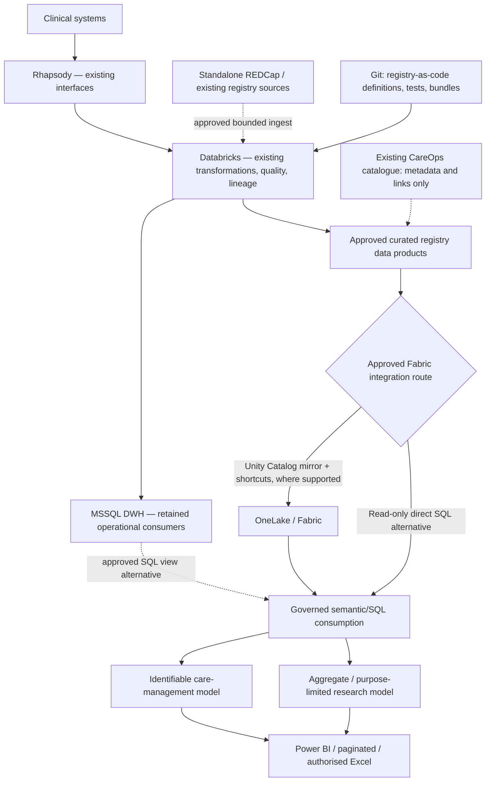
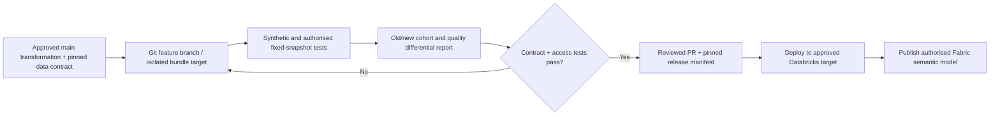

# Virtual clinical registry — reference design and contracts

**Status:** proposed architecture / decision record, 13 November 2026. No clinical integration, tenant deployment, consent waiver, HREC authorisation or research access is implied.

## Architecture decision

**Reuse the current data backbone**: Rhapsody → Databricks → MSSQL warehouse. Databricks remains the primary integration/transformation and data-quality plane; existing MSSQL reporting remains intact. Publish only authorised, curated Delta/SQL data products to Fabric/OneLake, with **Databricks Unity Catalog mirroring and OneLake shortcuts preferred only if compatible and approved**. Direct Databricks SQL/MSSQL consumption or selective mirroring is a tested fallback, not simultaneous uncontrolled replication.

Mermaid source:

The logical Bronze/Silver/Gold medallion stages can remain in Databricks. Fabric does not require duplicate raw ingestion or a new warehouse. Fabric Gold consumption is an *authorised presentation boundary*, not automatic anonymisation. Any direct-care identity resolution must remain in a restricted clinical plane; DDM is cosmetic/inference-vulnerable and not the security perimeter.

## Platform responsibility and ownership

| Component | Owner role / contract |
| --- | --- |
| Rhapsody | Existing clinical messaging/interface ownership, source event identity and ingestion time; no registry-specific fork of live feeds. |
| Databricks | Existing transformation and validation authority; publish versioned, stewarded, purpose-limited clinical tables/views. |
| MSSQL DWH | Keep existing operational reporting and data contracts unchanged unless explicitly versioned/migrated. |
| Existing REDCap/state/national registries | Retain standalone collection, custodianship, consent, approved purpose and external sharing constraints. |
| Fabric / OneLake | Read-only authorised consumption/federation, separately enforced permissions, semantic model refresh and access audit. |
| SharePoint CareOps catalogue | Reference-only inventory; links to existing custodians, permitted uses, documents and data product versions. Not a clinical data store or an approval engine. |
| GitHub | Public synthetic code, definitions, declarative pipeline configuration and verification evidence **without patient data or private tenant configuration**. |

## Versioned contracts (initial proposal)

1. **RegistryDefinition v1** — registry ID and owner; clinical purpose; version; inclusion/exclusion predicates; coding systems and their versions; time windows; derived fields; validation plan; links to existing data-use approvals. Explicitly distinguish screening logic from clinically adjudicated truth.
2. **SourceDataProduct v1** — source system/qualified table; steward; grain and keys; field meanings; classification; authorised purpose; source/version/watermark; expected freshness; allowed linkage paths.
3. **TransformationRun v1** — `git_commit`, bundle/pipeline identifier, registry definition version, input source snapshot/Delta version, executed-at, rule version, output version, counts, missingness, drift metrics, validation result. Do not assume Delta time travel provides indefinite archival retention.
4. **ConsumptionPolicy v1** — clinical/research purpose, role/group, allowed rows and columns, permitted identification/re-identification, extraction formats, expiry, audit requirements, authorising custodian/decision reference. Do **not** encode individual credentials or approvals in public Git.
5. **RegistryIntegration v1** — whether registry is catalogued/described/connected/analysed; upstream owner; connection type; read-only contract; permitted consumers; explicit link to existing authorisation; offboarding route.

## Source, fork and release lifecycle

A clinical scientist can fork *code* and definitions without forking an EMR feed or copying protected production data into Git. The PR reports logic changes and whether they affect eligibility, numerators/denominators, clinical outcomes, missingness or performance. Preserve old versions and migration mapping; require a separate release and clinical review when a definition changes measurement meaning. Store a durable, policy-compliant snapshot if prolonged reproducibility is necessary; Delta VACUUM/log retention are not indefinite.

## Security and failure modes

- Treat Unity Catalog and Fabric/OneLake as **separate enforcement domains**: mirrored shortcuts do not inherit every Databricks row/column policy. Deny by default until Fabric rights and data exposure are explicitly qualified.
- Avoid broad workspace Member/Contributor access for clinicians; configure semantic RLS/OLS and OneLake/SQL permissions for each reachable access route. Test using genuine role impersonation or approved test identities, not screenshots of filtered reports.
- Separate care-team worklists with identifiers from restricted QA/approved research cohorts. Retain small-cell suppression and re-identification risk review for remote FNQ subpopulations.
- A Power BI label, dynamic data mask or hidden report column is not data authorisation. Validate Excel/CSV/PDF export and direct endpoint routes individually.
- An unavailable source, stale watermark or failed linkage must be surfaced in the dataset fitness report; never silently label a cohort complete.
- No clinical alerting, device writeback, autonomous AI, research use or cross-organisation linkage until separately risk-assessed and authorised.
- Preserve Aboriginal and Torres Strait Islander data governance, community-specific confidentiality and appropriately scoped approval as relevant to proposed uses.

## Design decisions / non-goals

**D1:** Reuse source registries and their approvals; no mandatory migration.  
**D2:** A catalogue records pointers, not duplicated patient records or decisions.  
**D3:** Git, Databricks bundles and run manifests enable fork/diff/replay; separate deployment lifecycle from research use.  
**D4:** Use Fabric capabilities only where current tenant/licensing/security supports them; direct MSSQL/Databricks SQL is an acceptable initial pilot.  
**D5:** OMOP and FHIR are optional interoperability/research projections, not mandatory persistence schemas.  
**D6:** Future frontier ideas (NLP, trials, digital twin, geospatial analyses) must not become MVP gates.

## Qualification evidence

Source acceptance: synthetic datasets, schema validation, pipeline unit/property tests, SQL/Power BI role matrix, deterministic replay and security-negative tests. Tenant acceptance: QH-approved environment, read-only connectivity, measured freshness, access verification, logs and permitted export behavior. Clinical acceptance: expert-adjudicated ascertainment, cohort definitions, approved use, documented limitations, quality outcomes. Each gate remains independently open until evidenced.

See [requirements](requirements.md), the [existing CareOps catalogue design](../clinical-data-catalogue/architecture.md) and [Conductor track](../../conductor/tracks/virtual_clinical_registry_20261113/index.md).
