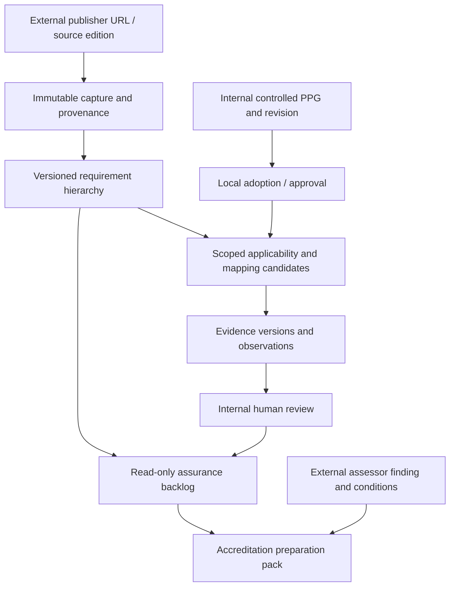

# Technical architecture and source hierarchy

## Preserve current source of truth

The existing PPGWorkbench code and SharePoint-owned policy records remain authoritative for **local controlled documents**. External publishers retain authority over their own source editions, and external accreditation bodies retain authority over ratings, conditions and awards. The CareOps accreditation graph is a *projection and evidence trail*, not a second publisher or assessor.

Every relationship carries `source_id + edition/version + scoped identity + assessment date + provenance`; avoid a single mutable URL or free-text document title as the join key.

### Four independent dimensions

1. **Source document and force** — internal controlled PPG vs external publication; legislation/HSD/protocol/policy/standard/guideline/accreditation criterion; issuer, provenance, effective dates, supersedes and source trust.
2. **Local adoption** — approved local policy version and authority, affected service/scope, conflicts, explicit non-adoption/exception, consultation and effective dates.
3. **Application evidence** — control/implementation claim, source/observation/evidence versions, sample/window, missing data, audit, optional process signals, owner and expiry.
4. **Assessment and accreditation** — internal review against requirement and scope, external independent assessor/report/decision/rating, conditions and follow-up. No universal score.

### Hierarchy and obligations

Jurisdictional health-service directives may bind a health service within their own scope; publisher guidelines and supporting resources can have different force. Keep the actual jurisdictional legislative reference in the private or profile-owned source register. Policy document types must preserve the publisher's declared normative status and actual relevant scope. A source becoming visible does not automatically alter any local operative policy. If external requirements conflict, record both source clauses and an owner-resolved interpretation; no priority heuristic automatically resolves law or clinical risk.

A policy may satisfy multiple requirements, and a requirement may need multiple policy/control/evidence records. Mappings are versioned many-to-many, partial by default, supported by exact source locators, and require explicit review. Do not copy full copyrighted college standards into Git; store metadata and published access routes, while retaining permitted source captures in approved private records.

### Scheme-specific accreditation

- **NSQHS / AHSSQA** — health service / site and applicable assessment cycle; operative second edition (with relevant advisories and workbook). Draft third edition has a different identity and should be a transition monitor, not a live assessment rule.
- **RACP** — Basic Training Provider Standards and distinct adult/paediatric accreditation requirements, with training-provider and program/scope identity. Later advanced training modules require their own profiles.
- **ANZCA/FPM** — training setting standards and college-specific requirements; distinguish 2026 preparation from later implementation, and programme/site approval from hospital accreditation.
- **RACS** — hospital/training-post and specialty-specific requirements; retain existing and AMC-aligned future editions independently. A service hospital rating cannot automatically stand in for an individual specialty post.
- Add AMC model standards, other college/specialty/accreditation schemes only after precise, reviewed source capture and scope; do not invent a publisher rating vocabulary.

### Architecture boundaries

All core operations can be built and verified offline in Python 3.15.1: source/edition contracts, typed snapshots, diff and applicability, scope/test fixtures, evidence mapping, read-only projection, adversarial invalidity checks and reproducible export. Native SharePoint Lists/Libraries, Power Automate flows, role controls, Teams UI and Power BI require tenant/runtime qualification. Optional Fabric/Dataverse and model services remain separate.

Privacy: do not put original internal policy text, source extracts with restricted terms, URLs containing access tokens, private accreditation reports or identifiable reviewer records in Git. Use synthetic fixtures and opaque identifiers only. A source citation/provenance pointer is not authority certification.

## Reuse existing modules (optional contracts)

PPG owns policies and requirement linking. Decisions owns committee decisions; Process owns event-process telemetry; Clinical Hub owns meeting evidence; RIMS may consume publications; Finance/Costing owns financial projections. Link with typed, source-qualified immutable references; do not reproduce operational registers across modules.

## Current references

- ACSQHC NSQHS second edition: https://www.safetyandquality.gov.au/resources/national-safety-and-quality-health-service-standards-second-edition
- ACSQHC third-edition consultation, piloting and transition: https://www.safetyandquality.gov.au/news-and-media/consultations/nsqhs-standards-third-edition-consultation
- Jurisdictional directive catalogue: supplied by the organisation-specific deployment profile; no operational binding in portable source
- RACP Training Provider Standards: https://www.racp.edu.au/about/accreditation/basic-training/standards-and-requirements
- ANZCA training-setting transition: https://www.anzca.edu.au/education-and-training/anaesthesia-training-and-pathways/anaesthesia-training-program/anaesthesia-training-sites-and-rotations/new-accreditation-standards-and-procedures
- RACS training post accreditation: https://www.surgeons.org/Trainees/training-post-accreditation

URLs are **candidate access routes only**, not fetched source-byte receipts or legal determinations.

## Source authority, local adoption and accreditation scheme identity

`ppg_scheme_adoption.py` already configures **accreditation scheme membership/rating vocabulary** against the existing framework graph. The new `ppg_obligation_application.py` instead records a **local controlled-document adoption**, version-bound to an EvidenceVersionKey and service ScopeKey with a human decision reference. One does not imply the other. Neither is a substitute for the accreditor's own award or site-specific college training-post decision.

The `ppg_evidence_currency.py` review window is distinct from source edition authority and actual application. The `ppg_assurance_bundle.py` is a derived, non-authoritative view only; review candidates are not issued tasks. The source-only SharePoint schema generator validates standard `shared_sharepointonline` fields for these overlays, and must be reconciled with the existing native PPG Lists before any deployment.
