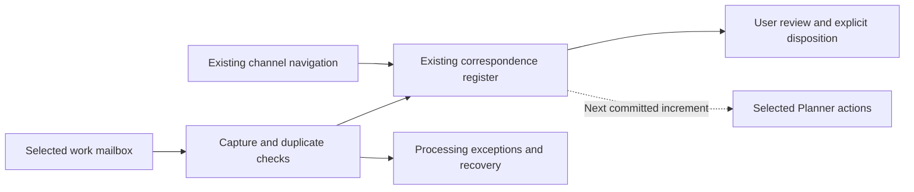

# Simplified implementation plan

## H2.4c source release-boundary review complete —28October2026

[Review decision and retained conditions](h2-release-boundary-review.md): bounded
source checkpoint ACCEPT; native H2 readiness HOLD. Fresh full offline suite1194
passed; no new blocking source defect found. No executable/test/fixture/dependency
change. H1-G01–03, H2-U01–05, H2-R01–04 and native H2.4b remain OPEN; H2 is not
globally complete. No publication, H3/H4 or live release selected. No native calls,
flow changes/runs, deferred correspondence work or emails.

## H2.4b source candidate/rollback materials prepared —28October2026

[Source materials and native gates](h2-native-source-preparation.md): two fictional
F07 alternatives, two calendar input pairs, seven refusals and49 focused tests.
Local preimage retention is not native rollback; the F07 alternatives share one
synthetic target, and a native per-operation bridge remains missing. No executable,
fixture, dependency or catalogue change. H1-G01–03, H2-U01–05 and H2-R01–04 remain
OPEN; native H2.4b and H2.4c unselected/pending. No native calls, flow changes/runs,
deferred correspondence work, emails or publication.

## H2.4a source baseline/fallback rehearsal complete —28October2026

[Rehearsal and retained limits](h2-fallback-rehearsal.md): six DOCX drafts match
the pinned source baseline; five review dispositions retain values/keys.313
affected tests passed;1194 full-suite evidence reused after135 source/test/config
files were verified unchanged. No executable/fixture/dependency change. Retain the
maintained Word/manual route and dated native proof; no new native proof inferred.
H1-G01–03, H2-U01–05 and H2-R01–04 OPEN; H2.4b/c pending/unselected. No native
call/change/run, live-flow/deferred correspondence work, email or publication.

## H2.3c source isolation/recovery complete —28October2026

[Source rehearsal and native limits](h2-source-recovery.md):41 fictional cases
reuse existing selection/adapters and commit-preview recovery checks. Fixed
returned nested-result aliases in the pure preview; source semantics/keys remain
unchanged.189 focused tests passed. Native audience/access, atomic reservation,
save/readback and historical restoration remain unqualified (H2-R01–04), so the
broader task is partial. H1-G01–03 and H2-U01–05 remain OPEN; H2.4 unselected.
No native call, flow change/run, deferred correspondence work or email.

## H2.3b operator configuration assessed —28October2026

[Inventory, design and qualification gaps](h2-operator-configuration.md): four
guarded exact CLI GETs confirmed existing library metadata/forms and F07/F12
manual inputs. Inventory/design complete; full no-code configuration remains
unqualified (H2-U01–05), so H2.3b is partial and manual preparation is retained.
No schema/form/flow/settings change, invocation or email. H1-G01–03 remain OPEN;
H2.3c/H2.4 pending/unselected. Live flows and deferred correspondence untouched.

## H2.3a source compatibility complete —28October2026

The [bounded compatibility adapters](h2-forum-reuse-plan.md#h23a-source-compatibility-adapters-implemented)
reuse legacy preparation/carry-forward, F07 candidate construction and full F12
validation with pinned context/source/identity checks. Existing builders/schemas,
flow catalogue, references and fallback routes are unchanged. H1-G01–03 remain open;
no actual authority, source access, native control or runtime is qualified here.
H2.3b/c and H2.4 remain pending. No native call, live-flow/configuration change,
deferred correspondence work, email or publication occurred.

## Selected H2 source increment —28October2026

H2.1 and H2.2a/b are complete at source-only scope. The
[reuse/configuration plan and executable contract](h2-forum-reuse-plan.md#h21-source-reuse-and-storage-map-implemented-scope)
record exact reuse/storage mapping, a pure resolver, two fictional profiles and
review-only inputs compatible with existing preparation and F12 validators.
Legacy modules, native schema assumptions and canonical source pins are unchanged.
H1-G01–03 remain open. H2.3 adapters/UI/native recovery and H2.4 remain pending;
no native authority/runtime or real-forum readiness is established. No native
call, live-flow/correspondence change, email or publication in this increment.

## Current forum reuse disposition —28October2026

H1 discovery is closed by explicit user direction with approval gaps retained,
not waived. Earlier partial markers below are dated discovery checkpoints.
Clinical Directors adopted arrangements, Medication Safety authoritative edition/
reporting, and CMO/EDMS Performance authority/endorsement/records remain open.
The private comparison retains their evidence and H1-G01–03 references.

The [H2 reuse/configuration plan](h2-forum-reuse-plan.md) is prepared with a
source-level reuse map, granular tasks, tooling/permissions, minimal contract,
operator controls, focused verification and recovery. It preserves legacy routes,
manual review, existing records and the maintained Word/manual fallback.
H2.1/H2.2a/b source work is now selected/completed as described above. Later
adapters, native configuration/runtime and real forum pilots are not selected.
The earlier close-out/planning slice made no native calls, changes, flow runs,
correspondence follow-up checks, emails or publication.

## Current correspondence disposition — 27 October 2026

Technical continuity, configured access and operator handover are complete.
Ongoing automatic Planner operation is authorised and last verified On with both
enable flags true and normal15-minute recurrence. Existing capture/manual routes
are unchanged; manual correspondence closure is retained. The source compilers
still default Off for an uncommissioned deployment.

Use the [operator guide](correspondence-operations.md),
[completed continuity plan](../../../conductor/tracks/correspondence_system_20261027/plan.md)
and [completed automatic-worker track](../../../conductor/tracks/correspondence_planner_automation_20261027/index.md).
Actual ESO first use and fresh natural intake arrival are explicitly deferred;
first real eligible task creation remains prospective and activity-notice delivery
unobserved. Keep those follow-ups separate from technical completion. Optional
sources, summaries, reporting, classification and multi-task work remain deferred.
Standard connectors only; no Premium, Copilot or AI Builder is planned.

This documentation-only reconciliation reuses retained evidence; no native read,
change or send occurred. Local source qualification/commit is not a website update.
The following dated planning sections retain their original intent and pending
markers for provenance; they are not the current correspondence work queue or a
reason to restore an activation hold. The completed tracks above supersede their
route-absence, Planner-next and activation-held statements. Preserve other meeting
work, existing owners and private history; no broad rename or migration follows.

## H1 forum-profile discovery —27October2026

The selected bounded read-only discovery deliverable is complete with explicit
remaining gaps. Three private profiles compare purpose, chair/delegates,
secretariat, agenda, outcomes, approval, records/access, cadence and destinations.
Ten original source files passed byte/hash and stable before/after file-metadata
checks. Real papers, role assignments, native URLs/IDs and detailed comparisons
remain outside public source in the existing private preparation/review route.

- H1.1 calendar coverage remains partial: an exact calendarView read through the
  retained CLI workload returned403. No recurring-instance, exception/cancellation
  or organiser/chair verification is claimed. An existing connector probe needs
  native save/start/invoke operations and was not run under read-only authority.
- H1.2 source coverage remains partial: current adopted governance, complete
  performance inputs and some approval/records/access assertions remain unresolved.
  Search results, filenames, file versions and blank endorsement fields do not
  establish adoption, permission or absence of other sources.
- H1.3 comparison is complete with those limits. Preserve each forum's authority,
  reporting and agenda differences; reuse existing records, templates and preparation
  routes. This does not commission shared configuration or a live forum pilot.

Qualified SharePoint CLI/API GET search/file reads succeeded. The process reused
pinned workload authentication and guarded requests; no new client/consent,
connector, native configuration, activation or email was used. Standard connectors
only; no Premium or Copilot dependency. Deferred correspondence follow-ups are
unchanged. This is local documentation, not publication or operational acceptance.

### H1 continuation —28October2026

Eight additional source copies passed stable metadata and byte/hash checks.
Native forum governance files were located and explicitly remain unadopted drafts;
a recent divisional performance pack supplies representative service actions,
risks and data-lineage fields. Two differently named ToR copies proved byte-identical.
Approval/authority gaps remain; filenames, uploads and reporting periods are not
adoption or freshness evidence. H1.2 remains partial with narrower source gaps.

H1.1 remains partial: the scoped calendar denial was not repeated unchanged;
no qualified read-only connector was exposed, and the calendar UI fallback failed
because the local browser had no available profile. No calendar rendered, and no
recurrence/exception coverage is claimed. Existing connector probes need native
writes/runs and were not used. Preserve these specific recovery conditions rather
than changing clients, consent, profiles or flows. H1.3 comparison remains complete
with explicit gaps in the existing private preparation route. No H2/pilot work,
correspondence follow-up, native write, email or publication occurred.

### H1 calendar connector qualification —28October2026

The later explicit instruction authorised temporary execution of the existing
Standard Outlook connector probe. The bounded requesting-user calendar horizon
is now verified with complete successful window results, recurring groups,
exceptions and an explicit cancellation; organiser metadata is distinct from
chair authority. H1.1 is complete at that scope. An initial historical-window
gateway failure remains retained; smaller monthly windows recovered the missing
coverage without replaying successful reads. Each action/output was checked;
overall flow success alone did not establish complete coverage.

Both invocations ended and the exact original probe definition, full connections,
name and notification preference were restored Stopped, with independent native
readback. No live flow, deferred correspondence follow-up, mailbox/calendar item,
email or account notification preference changed. The earlier API denial remains
scoped; this connector qualification supersedes the calendar-access blocker.
H1.2 adopted-governance/approval gaps remain; H1.3 comparison is complete with
explicit limits. No shared configuration, live forum pilot or publication follows.

### H1 governance and approval evidence —28October2026

Eight additional originals passed stable metadata/byte/hash checks. They establish
a revised-governance transition and observed minute-confirmation practice, while
exposing different membership content under the same ToR edition label and a
proposed reporting-route change. Draft minutes, blank approval fields, filenames,
upload dates and working-paper locations do not establish current adoption.
The existing private comparison retains source locators and the unresolved
edition, authority, endorsement and official-records questions.

H1.1 remains complete at its qualified calendar scope. H1.2 remains partial for
current adopted authority/approval; H1.3 comparison is complete with explicit
limits. The saved revision message and its attached later edition are confirmed review
candidates with blank approval fields; metadata/search presence is not approval. The divisional performance review
may rely on an applicable existing framework; no new committee or standalone ToR
requirement is inferred. No H2 implementation or approval workflow is selected.
This continuation used native GET reads only: no probe/live-flow operation,
permission change, correspondence follow-up or email. Nothing published.

## Retained planning sequence

Earlier plan-only restrictions below describe the planning checkpoint; the current
source-delivery checkpoint above takes precedence. Native state remains private.

1. Finish the existing preparation → agenda/papers → minutes → actions route.
   Reuse working records and flows. Use existing SharePoint library columns and
   maintained Word templates with manual narrative/revisions, assuming no Copilot
   or Premium connectors; follow [the selected route](library-column-word-route.md).
2. Use an existing meeting entry point and preparation/follow-up views. Build a
   Power Apps interface only where the current surface leaves a concrete gap.
3. Preserve agenda IDs, paper links, decisions, conditions and actions across the
   cycle. Keep decisions in minutes and one authoritative action register.
4. Reuse selected CareOps Decisions patterns: meeting-series defaults, agenda
   sections, optional attendance/conflicts/quorum and appropriate record states.
   Do not import its entire architecture or force a Dataverse migration.
5. Defer identity synchronisation, service accounts, enterprise pipelines,
   transcription/AI and duplicate task trackers unless separately needed.

Each selected slice: implement, inspect saved configuration and actual output,
verify affected failure/recovery behaviour, record once and close technical scope.
Representative fictional inputs are sufficient. Real-register cutover or sending
records is a separate operation, not a universal software-completion gate.

Delivery lessons: use narrow source-to-output increments, stable identities,
whitelisted updates and commit-last checkpoints. Close a bounded working capability
without waiting for optional extensions. Retain native statuses in the private
operational workspace; never claim deployment from local source tests.

## Modular suite evolution — 18 October 2026

Use [the ordered low-hanging-fruit queue](suite-delivery.md) for development-first
dependency alignment, optional interoperability and structured-document improvements.
Preserve current work and historical completion evidence; these improvements do
not reopen completed MVPs or establish native deployment/operational acceptance.

## Historical CMO/EDMS correspondence planning baseline — 26 October 2026

Describe the proposed capability as **Executive correspondence and work coordination
(CMO/EDMS)**. CMO (Chief Medical Officer), EDMS (Executive Director of Medical
Services) and executive support officer are configurable roles, not assumptions
about one organisation's structure or delegations. Public GitHub documentation,
any website, examples and reusable code must be organisation-neutral. This is a
planned capability, not a claim of an installed or operational product.

The reusable model is selected email intake → correspondence register → human
review → selected linked Planner actions → explicit correspondence closure.
Start with one authorised work mailbox; a shared-mailbox adapter is optional.
Scope this increment to the requesting user's mailbox, access and authorised
resources. Do not inspect other people's workflows, permissions or working
practices, or require their participation. Keep duplicate handling, manual fallback,
partial failure and recovery explicit. Sender filters, addresses, people, tenant
IDs, native objects, connection references, local classifications and evidence
belong in private deployment bindings. Public examples use fictional inputs and
reserved example domains. Do not copy private Conductor findings into public docs.

**Correspondence solution constraints:** standard connectors only; no Premium
connectors, Copilot, AI Builder, custom connectors, premium HTTP actions or
Dataverse connector dependency. This applies to the MVP, committed Planner
increment and any later option while these constraints stand. Reuse existing
qualified connections and verify the exact operation's classification, licensing
and policy compatibility before selection. CLI/native API development access is
not permission to introduce a premium runtime dependency. If no supported standard
route meets a requirement, record the gap and retain the manual fallback; do not
silently substitute a paid or Copilot route.

### MVP and delivery order — selected plan, implementation not authorised

**MVP: reliably capture selected incoming correspondence once into the existing
log, provide a simple user review view, and make failures visible and recoverable.**
Include source facts/references, explicit reply/matter matching, duplicate control,
basic last-success/error visibility, manual fallback and a prospective start date.
Classification, priority and closure remain human decisions. Exclude historical
import, shared-mailbox capture, automatic email, AI, new apps and dashboards.

| Increment | Tasks | Completion boundary |
|---|---|---|
| 1. Feasibility and reuse | COR-01/02 plus early COR-04 access and prerequisite checks | Establish a viable standard-connector CLI route before detailed build; record effort-driving gaps |
| 2. Minimum correspondence contract | COR-03; finish COR-04 for exact targets | Agree only fields, matching and states required for initial capture |
| 3. Complete capture slice | COR-05/06/07/08 together | Capture, duplicate protection, basic exceptions and review form one usable increment; none is an optional reliability add-on |
| 4. Verify and stage activation | COR-09 | Qualify filtering, replay, failures, recovery and manual fallback before a separately selected activation |
| 5. Linked Planner actions — next committed increment | COR-12 | Explicit user-selected actions from reviewed correspondence, linked in both directions; no automatic task for every email |

COR-10 public-content cleanup runs in parallel. It gates public publication under
COR-11, not private technical qualification of the MVP. COR-11 records each
release's status separately; Planner does not delay MVP closeout. “Low effort” is
a planning hypothesis until connection, source-reference, duplicate and journal
prerequisites are qualified. No native build, activation or publication is
authorised by this plan update.

Before publication of this capability:

1. Inventory organisation-specific content in the parent, integrated module and
   each selected pinned module, including README/navigation, profile docs, generated
   documentation, templates, code defaults, fixtures and packaging metadata.
2. Generalise current product prose and examples. Replace the public local profile
   with an organisation-neutral example after preserving any required deployment
   guidance privately. Update links, tracks and publication inventories together.
   Treat jurisdictional rules as configurable deployment policy, not universal
   product requirements or a mechanical name substitution.
3. Review native-looking titles and technical identifiers separately. Genericise
   generated titles/defaults and fictional tests; retain required compatibility
   identifiers until a tested migration exists. Preserve immutable provenance and
   third-party attribution without presenting them as current product branding.
4. Verify generated outputs and changed links, run affected source/publication
   checks, and review remaining organisation-name/domain matches with explicit
   reasons. Selected submodules require their own qualified changes and pin updates.
5. Distinguish local edits, committed/pushed source and any rendered website.
   Inspect the actual published surface before claiming it has been updated.

The initial repository audit found local-organisation framing in the root README,
deployment profile, credentialing guidance and roadmap, plus module document/code
references. Cleanup is part of this plan, not completed by adding this requirement.
The private correspondence plan holds the exact remediation inventory. No bulk
rename, native object change, history rewrite or publication follows from this
planning update.

### Correspondence solution: conceptual map

This capability is a correspondence solution within Clinical Hub, distinct from
the meeting action register. Map the existing assets before designing additions:

| Component | Responsibility | Reuse approach |
|---|---|---|
| Selected work mailbox | Source messages from a configured sending office | Existing authorised Outlook connection; qualify the requesting user's exact route |
| Existing correspondence List | Matter identity, receipt/source references, reviewed classification and disposition | Preserve IDs, field names, history and current manual entry |
| Power Automate | Capture, matching, duplicate control and processing receipts | Adapt a suitable user-owned flow if found; otherwise bootstrap a minimal flow from qualified existing components |
| Existing storage and channel | Source references and navigation | Reuse existing locations without changing access or assuming shared visibility |
| Conductor | System map, tasks, decisions and verification status | Generic public plan with private deployment bindings and native evidence |
| Planner (next committed increment) | Explicitly selected actions linked to reviewed correspondence | Qualify an existing suitable Basic plan and standard connector route after the MVP; bootstrap minimally if needed |

### Task checklist — plan only, 26 October 2026

Current authorisation update: the user selected feasibility/reuse and guarded CLI
qualification, including local source/tests and bounded native reads. Native
changes, flow invocation/activation and email sending remain on hold. The
[qualified read-only adapter](tool-routing.md#qualified-correspondence-reader--local-source-and-bounded-native-reads)
now has offline guard tests and scoped read evidence. This does not qualify the
mailbox intake, writes or runtime. Exact task evidence/status remains in the
private deployment record; unchecked tasks below are not a claim that discovery
or local guard preparation has never occurred.

Existing scoped discovery supplies evidence for COR-01; its mapping is not yet a
complete runtime qualification. All tasks below remain pending. No implementation
or publication follows from this checklist. Statuses must distinguish source
prepared, native configuration verified and operational rollout.

- [ ] **COR-01 — Map existing assets and dependencies.** Use qualified CLI GET/list
  operations and existing catalogues for the user's authorised resources. Record
  logical roles, bindings privately, current state, dependencies, evidence and gaps.
  Complete when the conceptual map reconciles to exact inspected assets; an absent
  inventory result is not proof that no flow exists.
- [ ] **COR-02 — Select reuse and bootstrap path.** Depends on COR-01. Classify each
  component as reuse unchanged, adapt, bootstrap or defer, with a concrete gap and
  reason. Reuse qualified Outlook/SharePoint connections, identity/duplicate checks,
  controlled updates and readback patterns. Preserve existing working flows and
  probes; do not repurpose unrelated meeting flows or inspect others' workflows.
  Create a minimal new flow only where existing authorised assets cannot meet the
  contract; never recreate the entire system by default.
- [ ] **COR-03 — Define the correspondence contract.** Depends on COR-01. Specify
  message versus matter identity, exact sender selection, replies/forwards, field
  authority, deadlines, review/waiting/closure states and manual-capture overlap.
  Define attachment/source-link treatment, minimum retained data and excluded
  content. Complete with a field mapping and fictional examples; preserve legacy
  values and do not bulk-classify existing records.
  The prepared [minimum contract](correspondence-contract.md) and
  [local candidate compiler](../scripts/correspondence_capture.py) now provide
  the field/matching/recovery design and fictional checks. Schema/connection and
  native runtime qualification remain separate; no intake activation is selected.
- [ ] **COR-04 — Qualify the user's CLI route and save prerequisites.** Begin with
  COR-01/02; finish exact-target checks after COR-03. Verify connection identity,
  standard-connector eligibility, selected mailbox/folder behaviour and target
  permissions using existing qualified clients. Resolve the recorded journal issue
  without fabricating history or weakening checks before any native save. Record
  connection expiry/recovery responsibility and scope any denial to its operation.
  Do not examine another person's access or grant additional permissions.
  Follow the [correspondence tool/access runbook](tool-routing.md#correspondence-solution-execution-map--26-october-2026),
  including the guarded-entry-point coverage check before any CLI execution.
- [ ] **COR-05 — Prepare the bounded capture implementation.** Depends on COR-03/04.
  Bootstrap/adapt the selected Power Automate definition and configuration through
  CLI/native APIs; local scripts only prepare and verify. Prefill the existing log
  from the selected intake with an explicit review state. Exclude send/reply/forward,
  mark-read and move actions. Start with prospective capture, not historical import.
  Complete when the exact candidate, bindings, change diff and rollback are reviewable.
  Native preparation may be saved Stopped after schema/connection qualification;
  retain CaptureEnabled=false and a future boundary. This is not runtime acceptance.
  Technical receipts can use a separately authorised existing site; never infer
  site-level list-create permission from permissions on an existing list.
- [ ] **COR-06 — Add duplicate prevention and reconciliation.** Depends on COR-05.
  Handle repeated triggers, concurrent arrivals, manual-entry overlap and an uncertain
  create result. Record processing identity and checkpoints; verify the existing
  result before retrying. Complete when fictional replay/partial-save cases preserve
  one correspondence identity and human edits. This is required before activation.
- [ ] **COR-07 — Add capture health and exception recovery.** Depends on COR-05/06.
  Reuse existing logging where suitable; show last success, unresolved failures and
  source-window reconciliation, including failures before a log entry exists.
  Define bounded outage catch-up and connection-expiry recovery with no automatic
  email. Complete when a missed/failed case can be detected and safely reconciled.
  For bounded native qualification, isolate fictional inputs/targets and inspect
  complete paginated actions plus persisted records. Inject create/receipt failures,
  prove replay skips another create, then restore the exact baseline Stopped.
  Keep arrival/outage/concurrency and actual source-link proof separate; a successful
  fictional batch does not close these dependencies or authorise live intake.
- [ ] **COR-08 — Provide the minimum user working surface.** Design after COR-03
  alongside COR-05–07; finish against their actual outputs before COR-09.
  Reuse the channel/log entry point and existing fields for user review, waiting and
  processing exceptions. Preserve All Items and manual entry. Document source-link
  limits without inspecting anyone else's mailbox or access. Complete with saved
  view readback and a concise [operator guide](correspondence-operations.md); no ESO-specific view or handoff task.
  Prioritise this independent working surface after bounded capture/source checks;
  preserve an explicit unresolved-link acceptance item without introducing a new
  ID-conversion service. Check native field choices before defining view predicates.
- [ ] **COR-09 — Verify and stage rollout.** Depends on COR-05–08. Use CLI/native API
  readback and fictional inputs to verify filtering, capture, links, duplicates,
  protected/missing content, concurrent edits and recovery. No test email sending.
  Record a prospective start boundary, stop switch, rollback and manual fallback;
  verify flow definition, state, output and requesting-user access separately.
  Activation is a distinct later selected step, not implied by local checks.
  Follow [bounded readiness checks](correspondence-readiness.md); keep native failure
  termination and actual overlapping-write evidence distinct from batch success
  or serial replay. Prepare a finite pilot proposal before any activation decision.
- [ ] **COR-10 — Genericise existing public content.** Can proceed alongside COR-01–09.
  Apply the public-content inventory and remediation sequence above to current
  prose, examples, generated branding and code defaults. Preserve private mappings,
  historical provenance and compatibility contracts. Complete with reviewed residual
  matches, affected tests, valid links and updated publication inventories.
- [ ] **COR-11 — Verify public delivery and close technical scope.** Depends on COR-09/10
  for the integrated release; documentation-only updates can be qualified separately.
  Identify the actual GitHub/website surface, verify committed/published content and
  any rendered output. Record exactly which source/native/rollout stages passed,
  known limitations and recovery instructions. No deployment claim from source checks.
- [ ] **COR-12 — Linked Planner actions, next committed increment.** After COR-09
  qualifies the MVP, establish a suitable Basic plan and standard-connector CLI
  route under the same user/resource scope. Reuse a suitable existing plan/flow
  before bootstrapping. Provide an explicit create-linked-action operation from
  reviewed correspondence, with task responsibility, deadline and progress kept
  authoritative in Planner. Retain a correspondence reference in the task and a
  durable task link in the log. Qualify replay, task-created/link-save-failed
  recovery, user access and any platform notification effects; no unapproved email.
  Task completion must not close correspondence. No per-email automatic tasks or
  general two-way synchronisation. A route gap defers this dependent implementation
  while preserving the roadmap commitment and working MVP; no Premium/Copilot fallback.

### Future options — considerations only

These are not tasks, dependencies or additions to the first release:

- Additional authorised mailbox/source adapters, if coverage warrants them; qualify
  cross-source duplicate detection first.
- On-demand review summaries and deadline views, if native views are insufficient;
  use the preferred maintained SharePoint document route for selected documents.
- Aggregate capture-health and workload reporting, if simple counters no longer
  answer operational questions; avoid copying correspondence into another register.
- Deterministic classification suggestions using standard expressions/rules, only
  if a later requirement justifies them. Human review remains explicit; no AI,
  Copilot, AI Builder or premium connector implementation is planned.

Email delivery, automatic reminders, AI, dashboards, new applications and general
two-way synchronisation are not included. Future people/role-specific coordination
would require a separately selected scope; it is not a prerequisite for this solution.
